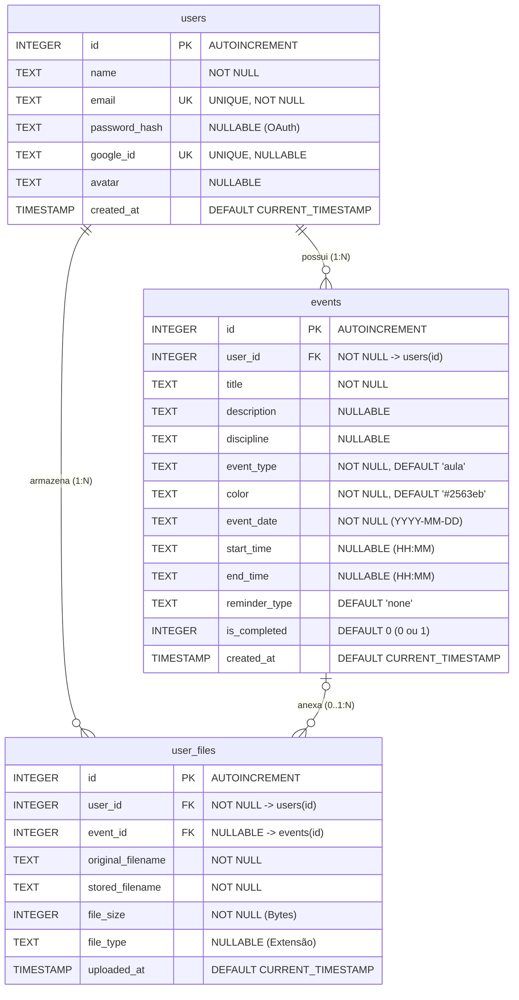

# 🗄️ Documentação do Banco de Dados e Dicionário de Dados — SIGOA

> **Sistema de Gerenciamento de Organização Acadêmica (SIGOA)**  
> Laboratório de Engenharia • Documentação Técnica de Persistência e Modelagem de Dados

Este documento descreve a arquitetura de persistência, o modelo relacional, as regras de integridade referencial, a conformidade com a LGPD e o **Dicionário de Dados** completo do banco de dados do sistema **SIGOA**.

---

## 📌 1. Visão Geral e Especificações Técnicas

O SIGOA utiliza um banco de dados relacional **SQLite 3** embarcado, projetado para oferecer alta velocidade transacional, portabilidade zero-configuração e isolamento rigoroso de dados por estudante.

| Propriedade | Especificação |
| :--- | :--- |
| **SGBD** | SQLite 3 |
| **Arquivo de Produção / Desenvolvimento** | `academico.db` (na raiz do projeto) |
| **Arquivo de Testes Automatizados** | `test_academico.db` (gerado e limpo por `test_app.py`) |
| **Módulo Gerenciador (DAO / Dal)** | `database.py` |
| **Integridade Referencial** | Ativada por conexão via `PRAGMA foreign_keys = ON` |
| **Formato de Retorno de Linhas** | `sqlite3.Row` (convertido em dicionários Python `dict`) |
| **Timeout de Conexão (Concorrência)** | `20.0` segundos |
| **Armazenamento Físico de Anexos** | Diretório `uploads/` (metadados persistidos na tabela `user_files`) |

---

## 🧩 2. Diagrama Entidade-Relacionamento (DER)

O modelo relacional é composto por **3 entidades principais**: **`users`** (Usuários/Estudantes), **`events`** (Compromissos Acadêmicos) e **`user_files`** (Arquivos e Materiais Acadêmicos).



### Resumo das Cardinalidades
1. **`users` (1) ─── (0..N) `events`**: Um estudante pode cadastrar vários compromissos acadêmicos; cada compromisso pertence exclusivamente a um único estudante.
2. **`users` (1) ─── (0..N) `user_files`**: Um estudante pode enviar múltiplos arquivos; cada arquivo pertence exclusivamente a um único estudante.
3. **`events` (0..1) ─── (0..N) `user_files`**: Um arquivo pode estar vinculado opcionalmente a um evento acadêmico específico (ex: enunciado de uma prova ou entrega de trabalho) ou existir de forma independente na biblioteca geral do aluno (`event_id = NULL`).

---

## 📖 3. Dicionário de Dados

Abaixo estão detalhadas todas as tabelas, colunas, tipos de dados, restrições e domínios do banco de dados.

---

### 3.1. Tabela: `users`
Armazena os dados cadastrais e credenciais de autenticação dos estudantes (suportando tanto cadastro local por e-mail/senha quanto login social via Google OAuth 2.0).

| Coluna | Tipo (SQLite) | Obrigatório | Chave / Restrição | Valor Padrão | Descrição e Formato |
| :--- | :--- | :---: | :--- | :--- | :--- |
| **`id`** | `INTEGER` | Sim | `PRIMARY KEY AUTOINCREMENT` | Auto-gerado | Identificador único sequencial do usuário. |
| **`name`** | `TEXT` | Sim | `NOT NULL` | — | Nome completo ou de exibição do estudante. |
| **`email`** | `TEXT` | Sim | `UNIQUE`, `NOT NULL` | — | Endereço de e-mail único utilizado para login (comparado com `LOWER()`). |
| **`password_hash`** | `TEXT` | Não | — | `NULL` | Hash criptográfico da senha gerado via `werkzeug.security`. Pode ser `NULL` quando a conta é criada exclusivamente via Google OAuth. |
| **`google_id`** | `TEXT` | Não | `UNIQUE` | `NULL` | Identificador único da conta Google (`sub` do token OpenID Connect). |
| **`avatar`** | `TEXT` | Não | — | `NULL` | URL da foto de perfil do usuário (proveniente do Google Sign-In). |
| **`created_at`** | `TIMESTAMP` | Não | — | `CURRENT_TIMESTAMP` | Data e hora de criação do registro em UTC (`YYYY-MM-DD HH:MM:SS`). |

---

### 3.2. Tabela: `events`
Armazena os compromissos acadêmicos da agenda do estudante (aulas, provas, entregas de projetos, seminários e lembretes).

| Coluna | Tipo (SQLite) | Obrigatório | Chave / Restrição | Valor Padrão | Descrição e Formato |
| :--- | :--- | :---: | :--- | :--- | :--- |
| **`id`** | `INTEGER` | Sim | `PRIMARY KEY AUTOINCREMENT` | Auto-gerado | Identificador único sequencial do evento acadêmico. |
| **`user_id`** | `INTEGER` | Sim | `FOREIGN KEY`, `NOT NULL` | — | Referencia `users(id)` com política `ON DELETE CASCADE`. Garante o isolamento do proprietário. |
| **`title`** | `TEXT` | Sim | `NOT NULL` | — | Título do compromisso (ex: *"Prova de Arquitetura de Computadores"*). |
| **`description`** | `TEXT` | Não | — | `NULL` | Descrição detalhada, conteúdo programático ou observações do evento. |
| **`discipline`** | `TEXT` | Não | — | `NULL` | Nome da disciplina ou matéria associada (ex: *"Laboratório de Engenharia"*). |
| **`event_type`** | `TEXT` | Sim | `NOT NULL` | `'aula'` | Categoria do evento. Valores aceitos: `'aula'`, `'prova'`, `'entrega'`, `'trabalho'`, `'outro'`. |
| **`color`** | `TEXT` | Sim | `NOT NULL` | `'#2563eb'` | Código hexadecimal da cor do marcador no calendário (ex: `'#dc2626'`). |
| **`event_date`** | `TEXT` | Sim | `NOT NULL` | — | Data do compromisso no formato ISO 8601 (`YYYY-MM-DD`). |
| **`start_time`** | `TEXT` | Não | — | `NULL` | Horário de início no formato 24h (`HH:MM`, ex: `'08:00'`). |
| **`end_time`** | `TEXT` | Não | — | `NULL` | Horário de término no formato 24h (`HH:MM`, ex: `'10:00'`). |
| **`reminder_type`** | `TEXT` | Não | — | `'none'` | Configuração de alerta interno. Valores: `'none'`, `'at_time'`, `'1h'`, `'1d'`, `'2d'`. |
| **`is_completed`** | `INTEGER` | Não | — | `0` | Flag booleana indicando conclusão do compromisso (`0` = Pendente, `1` = Concluído). |
| **`created_at`** | `TIMESTAMP` | Não | — | `CURRENT_TIMESTAMP` | Data e hora de criação do evento em UTC (`YYYY-MM-DD HH:MM:SS`). |

> **Nota sobre Campos Calculados em Consultas (`SELECT`)**:  
> Nas funções `get_events_by_user()` e `get_event_by_id()`, as consultas retornam dinamicamente a coluna virtual **`files_count`** (`INTEGER`), que contabiliza quantos registros em `user_files` possuem `event_id = events.id`.

---

### 3.3. Tabela: `user_files`
Armazena os metadados dos arquivos acadêmicos enviados pelos estudantes e o mapeamento para o arquivo físico salvo no diretório `uploads/`.

| Coluna | Tipo (SQLite) | Obrigatório | Chave / Restrição | Valor Padrão | Descrição e Formato |
| :--- | :--- | :---: | :--- | :--- | :--- |
| **`id`** | `INTEGER` | Sim | `PRIMARY KEY AUTOINCREMENT` | Auto-gerado | Identificador único sequencial do arquivo registrado. |
| **`user_id`** | `INTEGER` | Sim | `FOREIGN KEY`, `NOT NULL` | — | Referencia `users(id)` com política `ON DELETE CASCADE`. |
| **`event_id`** | `INTEGER` | Não | `FOREIGN KEY` | `NULL` | Referencia `events(id)` com política `ON DELETE SET NULL`. Indica o evento ao qual o anexo está vinculado (se houver). |
| **`original_filename`** | `TEXT` | Sim | `NOT NULL` | — | Nome original do arquivo sanitizado com `secure_filename()` (ex: `'Resumo_Calculo.pdf'`). |
| **`stored_filename`** | `TEXT` | Sim | `NOT NULL` | — | Nome único gerado para armazenamento físico no disco no formato `user_{user_id}_{timestamp}_{uuid8}.{ext}`. |
| **`file_size`** | `INTEGER` | Sim | `NOT NULL` | — | Tamanho total do arquivo em **bytes** (limite máximo configurado de `52.428.800` bytes / `50 MB`). |
| **`file_type`** | `TEXT` | Não | — | `NULL` | Extensão do arquivo em letras minúsculas sem ponto (ex: `'pdf'`, `'docx'`, `'png'`, `'zip'`). |
| **`uploaded_at`** | `TIMESTAMP` | Não | — | `CURRENT_TIMESTAMP` | Data e hora do upload do arquivo em UTC (`YYYY-MM-DD HH:MM:SS`). |

> **Nota sobre Junções (`JOIN`) em Consultas**:  
> Na função `get_files_by_user()`, é realizado um `LEFT JOIN` com a tabela `events`, adicionando os campos **`event_title`** e **`event_discipline`** ao resultado para exibição na biblioteca de arquivos do aluno.

---

## 🎨 4. Tabelas de Domínio (Valores Padronizados)

### 4.1. Domínio: Tipos de Evento (`events.event_type`) e Cores (`events.color`)
Definidos conforme a especificação visual do *Design Sprint*:

| Código (`event_type`) | Rótulo na Interface | Cor Padrão (`color`) | Nome da Cor | Uso Acadêmico |
| :--- | :--- | :---: | :--- | :--- |
| `'aula'` | Aula | `#2563eb` | 🔵 Azul | Aulas regulares e práticas de laboratório |
| `'prova'` | Prova | `#dc2626` | 🔴 Vermelho | Provas bimestrais, exames e avaliações |
| `'entrega'` | Entrega de Trabalho | `#16a34a` | 🟢 Verde | Submissão final de projetos, relatórios e listas |
| `'trabalho'` | Trabalho / Seminário | `#9333ea` | 🟣 Roxo | Apresentações, seminários e reuniões de grupo |
| `'outro'` | Outro | `#f59e0b` | 🟠 Âmbar | Compromissos gerais, monitorias ou eventos extras |

### 4.2. Domínio: Tipos de Lembrete (`events.reminder_type`)

| Código (`reminder_type`) | Descrição na Interface | Comportamento no Sistema |
| :--- | :--- | :--- |
| `'none'` | Sem lembrete | Não gera alerta antecipado específico |
| `'at_time'` | No horário do evento | Dispara notificação no horário exato (`start_time`) |
| `'1h'` | 1 hora antes | Alerta de proximidade imediata |
| `'1d'` | 1 dia antes | Destaque de atenção para o dia seguinte |
| `'2d'` | 2 dias antes | Alerta de preparação antecipada (48h) |

### 4.3. Domínio: Extensões de Arquivos Permitidas (`user_files.file_type`)
Configuradas em `config.py` (`ALLOWED_EXTENSIONS`), com limite de **50 MB** por upload:
- **Documentos e Textos**: `pdf`, `doc`, `docx`, `txt`, `md`
- **Apresentações e Planilhas**: `ppt`, `pptx`, `xls`, `xlsx`
- **Imagens**: `png`, `jpg`, `jpeg`
- **Compactados**: `zip`, `rar`, `7z`

---

## 🔗 5. Regras de Integridade Referencial e Exclusão

O banco garante consistência automática por meio de chaves estrangeiras ativas (`PRAGMA foreign_keys = ON`):

1. **Exclusão de Conta de Usuário (`DELETE FROM users WHERE id = ?`)**:
   - **Cascata em `events` (`ON DELETE CASCADE`)**: Todos os compromissos acadêmicos do usuário são automaticamente removidos.
   - **Cascata em `user_files` (`ON DELETE CASCADE`)**: Todos os registros de arquivos do usuário são apagados do banco, e a função `delete_user_account()` retorna a lista de `stored_filename` para que a aplicação remova também os arquivos físicos da pasta `uploads/`.
2. **Exclusão de Evento Acadêmico (`DELETE FROM events WHERE id = ?`)**:
   - **Preservação de Arquivos (`ON DELETE SET NULL`)**: Caso um evento que possua arquivos anexados seja excluído, os arquivos **não são apagados**. O campo `event_id` na tabela `user_files` passa automaticamente para `NULL`, mantendo o material disponível na biblioteca geral *"Meus Arquivos"* do estudante.

---

## 🛡️ 6. Segurança e Conformidade com a LGPD (Lei nº 13.709/2018)

A modelagem do banco de dados foi construída seguindo os princípios de *Privacy by Design*:

- **Minimização de Dados (Art. 6º, III)**: A tabela `users` armazena estritamente nome, e-mail e credencial de acesso, sem coletar CPF, telefone, endereço ou dados sensíveis.
- **Isolamento Multi-tenant (`WHERE user_id = ?`)**: Todas as queries de leitura, atualização e exclusão em `database.py` exigem obrigatoriamente o parâmetro `user_id` da sessão autenticada, impedindo acesso cruzado (*IDOR*).
- **Direito à Portabilidade (Art. 18, V)**: A rota `/api/user/export-data` extrai e consolida os registros das três tabelas (`users`, `events`, `user_files`) em um arquivo estruturado `meus_dados_lgpd.json`.
- **Direito à Eliminação / Esquecimento (Art. 18, VI)**: A função `delete_user_account(user_id)` executa o expurgo completo dos dados relacionais e arquivos físicos em disco.

---

## 💻 7. Script DDL (SQL de Criação do Esquema)

Caso deseje inspecionar ou recriar manualmente a estrutura em qualquer cliente SQLite (como *DB Browser for SQLite* ou *DBeaver*), utilize o script abaixo:

```sql
PRAGMA foreign_keys = ON;

-- 1. Tabela de Usuários
CREATE TABLE IF NOT EXISTS users (
    id INTEGER PRIMARY KEY AUTOINCREMENT,
    name TEXT NOT NULL,
    email TEXT UNIQUE NOT NULL,
    password_hash TEXT,
    google_id TEXT UNIQUE,
    avatar TEXT,
    created_at TIMESTAMP DEFAULT CURRENT_TIMESTAMP
);

-- 2. Tabela de Eventos / Compromissos Acadêmicos
CREATE TABLE IF NOT EXISTS events (
    id INTEGER PRIMARY KEY AUTOINCREMENT,
    user_id INTEGER NOT NULL,
    title TEXT NOT NULL,
    description TEXT,
    discipline TEXT,
    event_type TEXT NOT NULL DEFAULT 'aula',
    color TEXT NOT NULL DEFAULT '#2563eb',
    event_date TEXT NOT NULL,
    start_time TEXT,
    end_time TEXT,
    reminder_type TEXT DEFAULT 'none',
    is_completed INTEGER DEFAULT 0,
    created_at TIMESTAMP DEFAULT CURRENT_TIMESTAMP,
    FOREIGN KEY (user_id) REFERENCES users (id) ON DELETE CASCADE
);

-- 3. Tabela de Arquivos do Usuário
CREATE TABLE IF NOT EXISTS user_files (
    id INTEGER PRIMARY KEY AUTOINCREMENT,
    user_id INTEGER NOT NULL,
    event_id INTEGER,
    original_filename TEXT NOT NULL,
    stored_filename TEXT NOT NULL,
    file_size INTEGER NOT NULL,
    file_type TEXT,
    uploaded_at TIMESTAMP DEFAULT CURRENT_TIMESTAMP,
    FOREIGN KEY (user_id) REFERENCES users (id) ON DELETE CASCADE,
    FOREIGN KEY (event_id) REFERENCES events (id) ON DELETE SET NULL
);
```

---

## ⚙️ 8. Operações e Manutenção do Banco (`database.py`)

### Inicialização Automática e Seed de Dados
- Ao iniciar o servidor (`python app.py`), a função `db.init_db()` é chamada automaticamente, criando o arquivo `academico.db` e suas tabelas caso ainda não existam.
- Ao registrar um novo estudante, a função `db.seed_demo_data(user_id)` popula automaticamente **4 eventos acadêmicos de demonstração** no mês vigente (uma prova, uma entrega de banco de dados, uma aula prática de laboratório e um seminário) caso o usuário ainda não possua eventos cadastrados.

### Como Resetar o Banco de Dados em Ambiente de Desenvolvimento
Caso queira reiniciar o banco de dados do zero durante testes locais:
1. Pare a execução do servidor Flask (`Ctrl + C`).
2. Remova o arquivo `academico.db` e limpe os arquivos de teste em `uploads/`.
3. Inicie novamente com `python app.py` — o arquivo `academico.db` será recriado limpo automaticamente.
