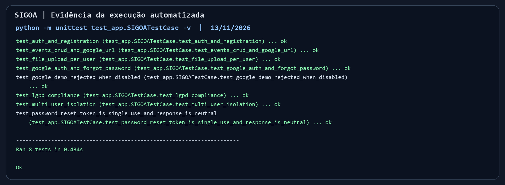

# SIGOA — Sprint 4: Qualidade, Estabilização e Entrega Final

**Universidade do Estado de Mato Grosso (UNEMAT)**  
**Disciplina:** Laboratório de Engenharia de Software  
**Integrantes:** Yuri Sardinha Milani e Emanuel Faria  
**Local e ano:** Cáceres — MT, 2026

## 1. Contexto da Sprint

O SIGOA (Sistema de Gerenciamento de Organização Acadêmica) foi criado para centralizar compromissos e materiais acadêmicos que costumam ficar dispersos entre diferentes canais. A primeira sprint estruturou a aplicação e a autenticação; a segunda consolidou o núcleo de agenda e eventos; o planejamento posterior ampliou o produto com arquivos, integrações e recursos de privacidade. Os documentos do projeto também registram um relatório técnico de implementação e um relatório recente de qualidade.

Esta Sprint 4 organiza o fechamento do trabalho: estabilizar o que já existe, tratar riscos conhecidos, validar os fluxos principais com evidências e preparar uma apresentação final honesta sobre resultados e limitações. O Relatório de Validação e Qualidade já registra oito testes automatizados aprovados, quatro achados corrigidos e retestes específicos. Esses resultados são apresentados como concluídos. As validações sem evidência — SMTP real, OAuth real, navegação ponta a ponta e avaliação com estudantes — permanecem pendentes.

## 2. Objetivo

Entregar uma versão demonstrável e documentada do SIGOA, com os fluxos principais revisados, os riscos de qualidade tratados ou claramente registrados, e evidências rastreáveis para a defesa do projeto.

Ao final da sprint, a equipe deverá conseguir demonstrar com dados fictícios: cadastro e autenticação; consulta e gestão de eventos; lembretes; anexos; exportação ou portabilidade de dados; isolamento entre usuários; e exclusão de conta. Também deverá explicar o que foi automatizado, o que foi inspecionado e o que ainda depende de validação externa.

## 3. Situação de entrada

O relatório de validação de 12 de novembro de 2026 registra oito testes automatizados executados e aprovados (zero falhas e zero erros), além de quatro achados corrigidos. O achado D-01, referente à redefinição de senha, permanece aberto: houve teste isolado de token com envio de e-mail simulado, mas SMTP real e fluxo completo não foram validados. OAuth real, fluxo interativo completo em navegador e testes de usabilidade com estudantes também não têm evidência registrada.

O mesmo relatório informa que a importação de horários por PDF foi conferida manualmente com arquivos de referência, mas o parser e o fluxo completo ainda não possuem testes automatizados nem validação de ponta a ponta. Os lembretes são exibidos na aplicação e não correspondem a notificações push ou e-mail. Configuração de produção, incluindo `SECRET_KEY`, `APP_ENV` e serviços externos, precisa ser conferida no ambiente de demonstração/implantação.

### Evidências já registradas para esta sprint

- Oito testes automatizados executados em 12/11/2026: oito aprovados, zero falhas e zero erros, conforme o relatório de qualidade.
- D-02 (modo Google Demo), D-03 (chave de sessão) e D-04 (escape de conteúdo) foram corrigidos segundo o relatório; os tipos de reteste variam entre teste automatizado e inspeção de código.
- D-05 (regras de lembrete) foi corrigido; há reteste automatizado para valor inválido e revisão estática da temporização visual.
- D-01 (redefinição de senha) continua aberto; SMTP real não foi testado.
- Não há evidência de teste de usabilidade com estudantes ou de execução ponta a ponta em navegador.

## 4. Escopo e prioridades

**Prioridade P0 — necessária para a entrega:** revisar o defeito D-01; executar novamente a suíte automatizada; fazer um roteiro manual dos fluxos críticos; verificar configuração segura e modo Demo; atualizar a documentação com resultados e limitações reais.

**Prioridade P1 — validação complementar:** testar a interface em navegador e diferentes larguras; conduzir uma avaliação breve com estudantes, se houver disponibilidade; validar o fluxo de importação de PDF e as integrações que forem utilizadas na demonstração.

**Fora do escopo desta sprint:** adicionar funcionalidades novas sem relação com estabilização, como chat, compartilhamento de agendas ou aplicativo móvel nativo. O foco é consolidar e evidenciar o produto construído.

## 5. Backlog da Sprint 4

Estimativas abaixo são uma proposta de planejamento em pontos de história. A equipe pode ajustar os pontos após dividir as tarefas, sem alterar os critérios de aceitação.

| ID | História / resultado esperado | Prioridade | Estimativa |
|---|---|---:|---:|
| S4-01 | Como estudante, quero concluir com segurança a redefinição da minha senha para recuperar o acesso à conta. | P0 | 8 |
| S4-02 | Como equipe, queremos repetir a suíte automatizada após os ajustes para confirmar que os fluxos cobertos continuam funcionando. | P0 | 3 |
| S4-03 | Como apresentador, quero percorrer os principais fluxos no navegador para verificar a aplicação integrada e preparar uma demonstração reproduzível. | P0 | 5 |
| S4-04 | Como estudante, quero que minha conta e meus dados permaneçam protegidos por configuração adequada e isolamento por usuário. | P0 | 3 |
| S4-05 | Como equipe, queremos validar a importação de horários por PDF e registrar claramente formatos aceitos e limitações. | P1 | 5 |
| S4-06 | Como estudante, quero compreender facilmente a agenda e as mensagens do sistema para usar as funções principais sem orientação. | P1 | 5 |
| S4-07 | Como avaliador, quero encontrar documentação atualizada de execução, testes, escopo e limitações para reproduzir e avaliar o projeto. | P0 | 3 |
| S4-08 | Como equipe, queremos organizar uma demonstração final com cenários, dados fictícios e evidências, reduzindo riscos durante a apresentação. | P0 | 2 |

**Capacidade proposta:** 34 pontos. O relatório de qualidade documenta a conclusão da regressão automatizada e a correção/revisão dos achados D-02 a D-05. A redefinição de senha (D-01) segue aberta. As validações integradas no navegador, SMTP real, OAuth real e usabilidade continuam pendentes conforme a evidência disponível.

## 6. Detalhamento das histórias e critérios de aceitação

### S4-01 — Redefinição de senha (D-01)

**Problema:** o relatório mantém aberto o fluxo de redefinição. A existência de uma rota ou de um teste isolado de token não comprova que o estudante consiga receber e utilizar o link real.

**Tarefas propostas:** reproduzir o problema; seguir o caminho completo de solicitação, geração do token, envio, abertura do link, validação de expiração/reutilização e gravação da nova senha; corrigir a causa; testar comportamento com e sem SMTP; atualizar o estado do achado.

**Critérios de aceitação:** a resposta à solicitação não revela se um e-mail está cadastrado; token válido e dentro do prazo permite redefinir a senha; token inválido, expirado ou já usado é rejeitado; senha abaixo do mínimo é rejeitada; a senha nova autentica e a antiga deixa de autenticar; token não é reutilizável; o envio real é confirmado se SMTP estiver configurado. Se SMTP real não puder ser configurado, o item não será declarado integralmente validado: registrar teste simulado, dependência e estado restante.

**Evidências:** resultado automatizado do fluxo de token; registro do teste ponta a ponta com SMTP, se disponível; descrição da configuração usada sem publicar segredos; atualização do D-01.

### S4-02 — Regressão automatizada

**Tarefas propostas:** executar a suíte existente em ambiente limpo; confirmar que cada teste usa dados temporários; registrar comando, data, versão do código, total executado e resultado; acrescentar casos somente para comportamentos alterados nesta sprint.

**Critérios de aceitação:** todos os testes existentes são executados; falhas são corrigidas ou registradas como impedimento; o relatório não confunde teste automatizado com teste de navegador, SMTP real ou usabilidade; os novos cenários relevantes para D-01 têm resultado reproduzível.

**Evidências:** saída integral ou resumo reproduzível da execução e lista dos cenários cobertos.

### S4-03 — Validação integrada no navegador

**Roteiro mínimo:** criar conta fictícia; entrar e sair; abrir a agenda; criar um evento acadêmico com categoria e lembrete; editar e concluir ou excluir o evento; anexar e baixar um arquivo permitido; conferir exportação disponível; repetir consulta com outro usuário e confirmar bloqueio dos dados alheios.

**Critérios de aceitação:** o roteiro é executado sem erro bloqueador no navegador; cada etapa possui resultado observado; falhas visuais ou funcionais são registradas com prioridade e evidência; a equipe identifica explicitamente os fluxos que não foram exercitados.

**Evidências:** checklist datado, capturas de tela sem dados pessoais e lista de defeitos/resultado.

### S4-04 — Segurança e configuração da demonstração

**Tarefas propostas:** confirmar `SECRET_KEY` não padrão e definida por variável de ambiente; verificar comportamento de produção e cookies; deixar Google Demo desabilitado por padrão em ambiente de produção; confirmar que segredos e arquivos de credenciais não estão na documentação ou no pacote entregue; revisar isolamento de eventos e arquivos por usuário.

**Critérios de aceitação:** aplicação não inicia em modo de produção sem segredo configurado; modo Demo segue a configuração documentada e não é tratado como autenticação Google real; o roteiro não expõe arquivos ou registros de outro usuário; limitações de OAuth e configuração externa são declaradas.

**Evidências:** checklist da configuração usada, resultado do cenário de isolamento e inspeção dos arquivos de configuração entregues. Não inserir valores secretos no relatório.

### S4-05 — Importação de horários por PDF

**Tarefas propostas:** selecionar PDFs de referência; identificar requisitos de formato pesquisável; testar parsing e criação dos horários; verificar dias letivos, fases e duplicidade; testar arquivo inválido ou incompatível; registrar resultados e limitações.

**Critérios de aceitação:** ao menos um cenário válido e um inválido são executados de ponta a ponta, se o recurso estiver disponível no ambiente; resultado importado é conferido contra a fonte; qualquer validação manual é identificada como tal; não se afirma cobertura automatizada se ela não existir.

### S4-06 — Usabilidade e compatibilidade

**Tarefas propostas:** observar de três a cinco estudantes, se houver disponibilidade, executando tarefas sem instrução passo a passo; verificar visualização em tela móvel e desktop, navegação por teclado, foco e clareza das mensagens.

**Critérios de aceitação:** registrar participantes de forma anônima, tarefas, conclusão, dúvidas observadas e sugestões; nunca registrar dados pessoais desnecessários; se não houver participantes, relatar que a validação de usabilidade permanece pendente, sem substituir isso por opinião da equipe.

### S4-07 — Documentação final

**Tarefas propostas:** revisar README e documentos; alinhar instruções de instalação/execução às tecnologias presentes; listar funcionalidades implementadas, testes executados, configurações externas, limitações e próximos passos; atualizar rastreabilidade entre histórias e evidências.

**Critérios de aceitação:** uma pessoa consegue localizar requisitos para execução; documentação não promete SMTP/OAuth ou importação PDF validados sem evidência; links e comandos correspondem ao estado atual do repositório.

### S4-08 — Demonstração final

**Tarefas propostas:** preparar ambiente de demonstração, dados fictícios e sequência curta; verificar que o ambiente está limpo; preparar evidências da suíte e dos achados; definir quem apresenta cada parte.

**Critérios de aceitação:** a equipe consegue repetir o roteiro; não são usados dados reais de estudantes; a demonstração informa o estado de D-01, integrações não exercitadas e limitações de validação.

## 7. Plano de execução sugerido

| Etapa | Atividades | Saída |
|---|---|---|
| 1. Preparação | Revisar D-01, priorizar tarefas, preparar ambiente e dados fictícios. | Backlog confirmado e roteiro de reprodução. |
| 2. Correção | Corrigir redefinição de senha e ajustes de segurança relacionados. | Código revisado e casos de teste atualizados. |
| 3. Verificação | Rodar regressão automatizada, fluxos de navegador e importação PDF priorizada. | Resultados datados e defeitos classificados. |
| 4. Validação | Avaliar usabilidade e compatibilidade quando houver participantes e ambiente. | Observações, métricas simples e limitações. |
| 5. Fechamento | Revisar documentação, preparar apresentação e atualizar estado das histórias. | Incremento demonstrável e relatório final coerente. |

## 8. Definition of Done

Uma história desta sprint só será considerada concluída quando:

- a implementação ou atividade estiver registrada no repositório/documentação;
- os critérios de aceitação forem verificados e a evidência estiver indicada;
- os testes relacionados forem executados, com resultado real registrado;
- defeitos restantes tiverem prioridade e estado explícitos;
- nenhuma senha, token, dado pessoal ou credencial real estiver exposto;
- a documentação refletir o comportamento observado;
- a equipe conseguir explicar o que foi feito e o que permanece pendente.

Para S4-01, teste com e-mail simulado não basta para afirmar que o envio real foi validado. Para S4-03 e S4-06, inspeção de código não substitui observação no navegador ou com usuários.

## 9. Riscos e impedimentos

| Risco / impedimento | Impacto | Ação de resposta |
|---|---|---|
| Ausência de servidor SMTP ou credenciais de teste | Não é possível comprovar recebimento do link de redefinição. | Executar o teste simulado, documentar a dependência e manter D-01 parcialmente validado/aberto. |
| Falta de credenciais Google válidas | OAuth real não pode ser demonstrado. | Usar modo de demonstração apenas em ambiente local controlado e identificar claramente que é simulação. |
| Formatos variados de PDFs acadêmicos | Parser pode falhar em arquivos sem texto pesquisável ou com leiaute distinto. | Definir formatos aceitos, testar exemplos e manter importação como validação parcial se necessário. |
| Tempo insuficiente para teste com estudantes | Não há evidência empírica de usabilidade nesta etapa. | Priorizar observação breve; se inviável, declarar pendência em vez de inventar resultados. |
| Diferença entre ambiente local e de implantação | Pode ocultar problemas de configuração, sessão ou integração. | Registrar ambiente utilizado e checklist de produção; não afirmar prontidão de produção sem validação. |

## 10. Resultado esperado e indicadores

O resultado esperado é um incremento estável para demonstração acadêmica, com trilha de evidências e limitações conhecidas. A meta não é declarar o produto livre de defeitos; é permitir avaliação reproduzível do que foi implementado.

Indicadores de saída:

- suíte automatizada: total executado, aprovados, falhas e erros;
- D-01: corrigido e validado ponta a ponta, parcialmente validado ou aberto, com justificativa;
- roteiro de navegador: etapas concluídas, falhas e ambiente utilizado;
- configuração: checklist de segurança preenchido sem expor segredos;
- usabilidade: número de participantes e tarefas concluídas, ou pendência declarada;
- documentação: README e relatório atualizados e coerentes com as evidências.

### Evidência de testes registrada

O Relatório de Validação e Qualidade informa a execução, em 12/11/2026, do comando `python -m unittest test_app.SIGOATestCase -v`, com o resultado **Ran 8 tests — OK**. Em 13/11/2026, reproduzi os mesmos oito testes a partir dos arquivos do projeto informados pela equipe. Os cenários cobrem cadastro e senha, CRUD de eventos, arquivos por usuário, isolamento multiusuário, modo Demo e recuperação, redefinição por token e direitos LGPD. O relatório também registra a análise de sintaxe do JavaScript no motor Chromium.

Além do resultado anterior, a equipe disponibilizou `test_app.py` e `app.py` no diretório do projeto. Em 13/11/2026, a suíte foi reproduzida em uma cópia isolada do código dentro do workspace, sem usar o banco de dados original: **oito testes executados, oito aprovados, zero falhas e zero erros**. A saída real capturada foi arquivada em `Evidencia_Testes_SIGOA_2026-11-13.txt` e representada visualmente na Figura 1. A execução cobre os cenários automatizados listados no relatório; não substitui teste de navegador, SMTP real, OAuth real ou usabilidade com estudantes.

**Comando:** `python -m unittest test_app.SIGOATestCase -v`  
**Ambiente da repetição:** cópia temporária dos módulos da aplicação e dos diretórios `templates/` e `static/`; banco SQLite e pasta de uploads de teste criados nesse ambiente isolado.

## 11. Sprint Review — resultados e itens pendentes

Os resultados abaixo reproduzem o Relatório de Validação e Qualidade, datado de 12/11/2026. Os campos pendentes não possuem evidência de execução nos documentos consultados.

| Item | Planejado | Resultado observado | Evidência | Estado |
|---|---|---|---|---|
| D-01 redefinição de senha | Corrigir e validar solicitação até troca de senha. | Teste isolado de token aprovado com e-mail simulado; fluxo real não confirmado como corrigido. | Relatório de qualidade; SMTP real pendente. | Parcial / aberto |
| Regressão automatizada | Executar os testes aplicáveis. | Oito testes executados, oito aprovados, zero falhas e zero erros, reproduzidos em 13/11/2026. | Saída real em `Evidencia_Testes_SIGOA_2026-11-13.txt`; Figura 1 neste documento. | Concluído no escopo coberto |
| Fluxo em navegador | Executar roteiro integrado com dados fictícios. | Não há evidência de execução ponta a ponta; sintaxe JavaScript foi analisada, sem exercício dos fluxos interativos. | Relatório de qualidade. | Pendente |
| Segurança da demonstração | Revisar segredo, Demo e isolamento. | D-02 corrigido e parcialmente retestado; D-03 corrigido por inspeção; isolamento multiusuário coberto nos testes. Configuração de implantação ainda requer conferência. | Retestes e inspeções registrados no relatório. | Parcial |
| PDF e usabilidade | Validar cenários complementares. | Importação de PDF conferida manualmente; parser/fluxo no navegador não testados. Não há sessão de usabilidade com estudantes. | Relatório de qualidade. | Parcial / pendente |
| Documentação e apresentação | Atualizar instruções e roteiro final. | Relatório inclui roteiro de defesa e limitações a comunicar. | Relatório de qualidade, seção 7. | Orientação documentada; apresentação ao vivo pendente |

### Incremento a apresentar

Apresentar a versão do SIGOA utilizada, os fluxos que foram realmente executados, os resultados dos testes automatizados e o estado de cada achado aberto. Identificar separadamente correção por código, teste automatizado, inspeção estática e validação com usuário.

## 12. Retrospectiva proposta

Preencher depois da review, com base nos registros da sprint:

- **O que funcionou:** identificar quais critérios e evidências foram obtidos com menor retrabalho.
- **O que dificultou:** registrar dependências externas, inconsistências entre planejamento e implementação e problemas reproduzidos.
- **O que aprendemos:** registrar o que os testes revelaram sobre integração, segurança e experiência do estudante.
- **O que faremos diferente:** definir ações concretas para próximos projetos, como testar integrações reais mais cedo ou manter critérios de aceite ligados a evidências.

Não atribuir resultados positivos ou problemas específicos sem observar a execução desta sprint.

## 13. Relação com os sprints anteriores

| Sprint | Direção registrada | Como a Sprint 4 dá continuidade |
|---|---|---|
| Sprint 1 — Fundação | Estrutura Flask, SQLite, autenticação e primeira agenda. | Reconfere configuração, sessão e base de execução antes da entrega. |
| Sprint 2 — Núcleo do MVP | CRUD de eventos, categorias e lembretes. | Reexecuta os fluxos de agenda e corrige regressões que afetem a demonstração. |
| Sprint 3 — Integração e evolução | Planejamento de integrações, arquivos e evolução do produto; relatórios posteriores registram anexos, exportação, LGPD e importação PDF. | Valida com evidência o que foi incorporado e explicita as integrações que continuam sem teste real. |
| Sprint 4 — Qualidade e entrega | Estabilização, verificação, documentação e preparação de apresentação. | Consolida o produto e fecha o ciclo com estado rastreável e limitações transparentes. |

## 14. Conclusão

A Sprint 4 registra um incremento de qualidade com evidências: oito testes automatizados aprovados, quatro achados corrigidos e retestes proporcionais aos cenários disponíveis. A redefinição de senha (D-01) permanece aberta porque o teste automatizado isolado não comprova o fluxo completo com envio real de e-mail. Também não há evidência de OAuth real, validação interativa completa em navegador ou usabilidade com estudantes. A importação de horários por PDF foi conferida manualmente, mas o parser e o fluxo completo ainda precisam de testes. Assim, o MVP é demonstrável com ressalvas, e as limitações devem ser apresentadas junto dos resultados.

## 15. Fontes consultadas

- SIGOA_Backlog_Sprint1_Blueprint.pdf — backlog, Sprint 1 e planejamento da Sprint 2.
- SIGOA_Backlog_Sprint2_Blueprint.pdf — núcleo do MVP, review da Sprint 2 e planejamento da Sprint 3.
- SIGOA_Sprint2_Nucleo_MVP_e_Planejamento_Sprint3.pdf — registro complementar da Sprint 2 e evolução planejada.
- Relatorio_Implementacao_SIGOA_MVP.pdf — rastreabilidade entre requisitos e funcionalidades implementadas.
- Relatorio_Validacao_Qualidade_SIGOA.pdf — resultados de teste, achados, riscos e limitações registrados em 12/11/2026.
- TRABALHO FINAL — LABORATÓRIO DE ENGENHARIA DE SOFTWARE.pdf — orientação para documentação de sprints, validação e análise crítica.

## 16. Referências técnicas

As referências abaixo são documentação oficial das tecnologias mencionadas nos documentos do projeto. Elas apoiam a descrição da stack; não substituem a inspeção do código-fonte nem comprovam, por si só, quais versões foram instaladas. Acesso em: 13 nov. 2026.

- PYTHON SOFTWARE FOUNDATION. **Python 3 Documentation**. Disponível em: https://docs.python.org/3/. Acesso em: 13 nov. 2026.
- PYTHON SOFTWARE FOUNDATION. **unittest — Unit testing framework**. Disponível em: https://docs.python.org/3/library/unittest.html. Acesso em: 13 nov. 2026.
- PALLETS PROJECTS. **Flask Documentation**. Disponível em: https://flask.palletsprojects.com/en/stable/. Acesso em: 13 nov. 2026.
- PALLETS PROJECTS. **Jinja Documentation**. Disponível em: https://jinja.palletsprojects.com/en/stable/. Acesso em: 13 nov. 2026.
- PALLETS PROJECTS. **Werkzeug Documentation: Utilities and Security**. Disponível em: https://werkzeug.palletsprojects.com/en/stable/utils/. Acesso em: 13 nov. 2026.
- SQLITE. **SQLite Documentation**. Disponível em: https://www.sqlite.org/docs.html. Acesso em: 13 nov. 2026.
- PYTHON SOFTWARE FOUNDATION. **sqlite3 — DB-API 2.0 interface for SQLite databases**. Disponível em: https://docs.python.org/3/library/sqlite3.html. Acesso em: 13 nov. 2026.
- TAILWIND LABS. **Tailwind CSS Documentation**. Disponível em: https://tailwindcss.com/docs. Acesso em: 13 nov. 2026.
- MOZILLA. **Fetch API**. MDN Web Docs. Disponível em: https://developer.mozilla.org/en-US/docs/Web/API/Fetch_API. Acesso em: 13 nov. 2026.
