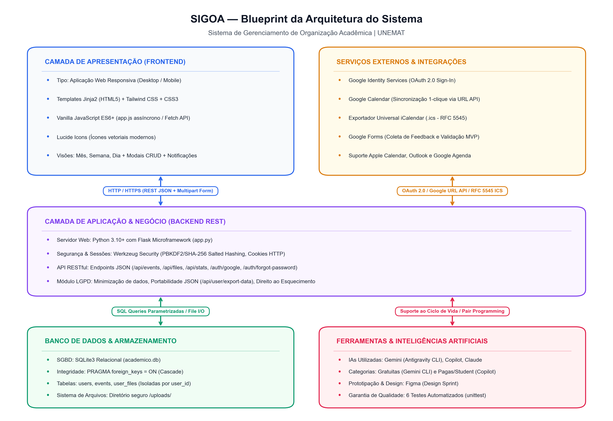
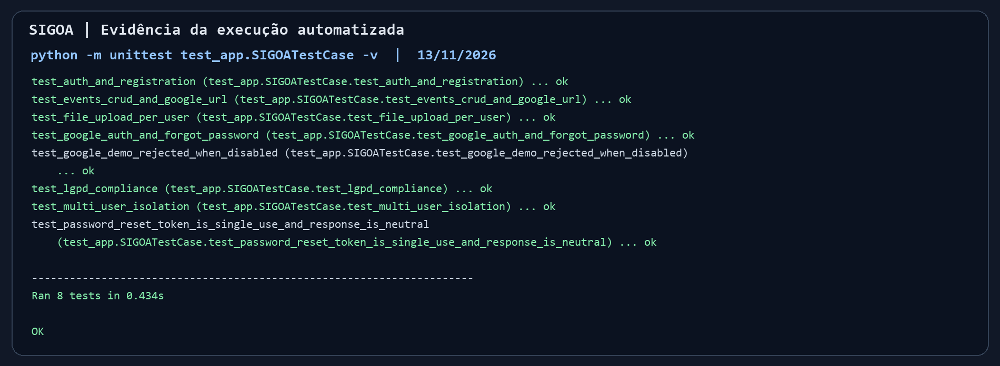

# TRABALHO FINAL — LABORATÓRIO DE ENGENHARIA DE SOFTWARE

**Da ideia ao MVP: análise, projeto, desenvolvimento e defesa de uma solução de software**

**Projeto:** SIGOA — Sistema de Gerenciamento de Organização Acadêmica  
**Instituição:** Universidade do Estado de Mato Grosso (UNEMAT)  
**Disciplina:** Laboratório de Engenharia de Software  
**Acadêmicos / Integrantes:** Yuri Sardinha Milani e Emanuel Faria

---

## 1. APRESENTAÇÃO

Ao longo da disciplina de **Laboratório de Engenharia de Software**, a equipe concebeu, projetou, desenvolveu, testou e documentou progressivamente o **SIGOA (Sistema de Gerenciamento de Organização Acadêmica)**, uma aplicação web responsiva voltada à centralização de compromissos, prazos e materiais acadêmicos de estudantes universitários.

Este **Trabalho Final** consolida e analisa criticamente todo o percurso de Engenharia de Software realizado pela equipe ao longo do semestre letivo, integrando os artefatos produzidos na fase de concepção (*Design Sprint: MVP em 7 Dias* e *Blueprint Arquitetural*) e a evolução incremental documentada nas quatro sprints do projeto:

- **Sprint 1 (`SIGOA_Backlog_Sprint1_Blueprint`):** definição do *Product Backlog*, *Blueprint* técnico da solução e construção da fundação executável (ambiente Python/Flask, banco de dados relacional SQLite, autenticação com hash criptográfico, controle de sessão e estrutura inicial da agenda mensal).
- **Sprint 2 (`SIGOA_Backlog_Sprint2_Blueprint` e `SIGOA_Sprint2_Nucleo_MVP_e_Planejamento_Sprint3`):** implementação e integração do núcleo operacional do MVP (CRUD completo de eventos acadêmicos via API RESTful e interface assíncrona com Fetch API, categorização visual por cores oficiais, configuração de lembretes, testes automatizados iniciais e planejamento evolutivo da Sprint 3).
- **Sprint 3 (`SIGOA_Sprint2_Nucleo_MVP_e_Planejamento_Sprint3` e `Relatorio_Implementacao_SIGOA_MVP`):** evolução funcional do sistema com visualizações semanal e diária, busca rápida no cliente, gestão de arquivos/anexos isolados por usuário, geração de URL para Google Calendar, exportação universal no padrão iCalendar (`.ics` — RFC 5545), importação de horários acadêmicos por PDF e recursos de conformidade com a LGPD (portabilidade em JSON e exclusão de conta em cascata).
- **Sprint 4 (`SIGOA_Sprint4_Qualidade_Entrega_Final` e `Relatorio_Validacao_Qualidade_SIGOA`):** auditoria técnica de qualidade, verificação e validação, classificação e correção de defeitos (D-01 a D-05), reprodução isolada da suíte de 8 testes automatizados e registro transparente das limitações e dependências externas para a defesa final.

Seguindo o princípio norteador da disciplina — **em Engenharia de Software, não basta dizer o que foi feito; é necessário explicar por que foi feito dessa maneira** —, cada seção deste documento apresenta não apenas os artefatos construídos, mas também as justificativas técnicas, alternativas consideradas, trade-offs assumidos e lições aprendidas em cada decisão.

---

## 2. ENTREGAS E ARTEFATOS DO PROJETO

### 2.1 Pitch da Ideia

- **Problema identificado:** estudantes universitários enfrentam descentralização severa de informações acadêmicas. Datas de provas, prazos de entrega de trabalhos, horários de aulas práticas, seminários e materiais de estudo são divulgados de maneira fragmentada entre grupos de WhatsApp, e-mails institucionais, murais físicos, ambientes virtuais distintos e avisos verbais em sala de aula.
- **Contexto:** no cotidiano universitário, um acadêmico cursa simultaneamente entre cinco e sete disciplinas com dinâmicas distintas de avaliação. A ausência de um ponto único de consulta e alerta eleva a sobrecarga cognitiva e provoca esquecimento de prazos importantes, perda de arquivos didáticos e queda no desempenho acadêmico.
- **Público-alvo:** estudantes de graduação do ensino superior (inicialmente validado com acadêmicos do curso de Ciência da Computação e Engenharia de Software da UNEMAT), bem como alunos de cursos técnicos e de pós-graduação que gerenciam rotinas acadêmicas intensas.
- **Necessidade ou oportunidade:** disponibilizar uma ferramenta leve, gratuita, acessível diretamente pelo navegador (desktop ou celular) e adaptada à semântica da vida universitária (disciplinas, provas, aulas, trabalhos, entregas e apostilas), sem a curva de aprendizado ou o excesso de configuração exigido por ferramentas corporativas de gestão de projetos.
- **Proposta de solução:** o **SIGOA (Sistema de Gerenciamento de Organização Acadêmica)** é uma aplicação web responsiva que centraliza a agenda acadêmica do estudante, permitindo cadastrar, editar, categorizar visualmente por cores e acompanhar compromissos com alertas de proximidade, anexar materiais de estudo aos eventos e exportar ou sincronizar a agenda com serviços externos.
- **Diferencial da solução:** diferentemente de agendas genéricas (que tratam qualquer evento de forma indistinta) ou de plataformas pesadas de produtividade (como Notion ou Trello, que exigem construção manual de templates pelo aluno), o SIGOA já nasce estruturado com **taxonomia acadêmica nativa** (Provas em vermelho, Aulas em azul, Trabalhos/Seminários em roxo, Entregas em verde), **painel de urgência de 48 horas**, **anexos vinculados diretamente ao compromisso acadêmico**, **exportação interoperável `.ics`** e **portabilidade/exclusão de dados em conformidade com a LGPD**.

#### Justificativa

- **Como a equipe identificou o problema:** o problema surgiu da observação direta da rotina acadêmica dos próprios integrantes e colegas de turma na UNEMAT, onde alterações de datas de provas e entregas anunciadas em diferentes canais frequentemente geravam desencontro de informações.
- **Por que esse problema merece uma solução:** a perda de prazos avaliativos impacta diretamente a retenção e o aproveitamento acadêmico do estudante. Resolver a dispersão de informações com um sistema simples reduz o esforço de organização e permite que o aluno concentre sua energia no aprendizado.
- **Quais evidências ou observações sustentaram a ideia:** durante a etapa de validação do *Design Sprint* (aplicada via Google Forms a estudantes do 6º semestre de Ciência da Computação), **75% dos respondentes declararam que simplesmente "não organizam" formalmente suas datas** e **25% utilizam apenas mensagens soltas no WhatsApp** (0% utilizava agenda de papel, Google Calendar ou aplicativos dedicados de forma estruturada).
- **Como a proposta inicial evoluiu ao longo do semestre:** na concepção inicial, a ideia abrangia diversas funcionalidades amplas (como chat entre alunos e geração automática de cronogramas por IA). No *Design Sprint* e na **Sprint 1**, o escopo foi rigorosamente delimitado para um núcleo executável (autenticação e visualização da agenda mensal). Na **Sprint 2**, consolidou-se o CRUD completo de eventos com categorias cromáticas e lembretes. Na **Sprint 3**, com a base estável, foram incorporadas evoluções de alto valor prático (visão semanal/diária, anexos por usuário, exportação `.ics`/URL Google Calendar, importação de horários por PDF e direitos LGPD). Por fim, na **Sprint 4**, o foco voltou-se à estabilização, segurança de sessão, correção de defeitos e validação com evidências reais de testes.

---

### 2.2 Persona e Jornada do Usuário

#### Persona Definida: Lucas Almeida (Estudante Universitário de Exatas)

- **Perfil do usuário:** Lucas, 21 anos, estudante do 6º semestre da área de Computação/Engenharia na UNEMAT. Utiliza notebook durante as aulas e laboratórios e smartphone ao longo do dia.
- **Necessidades:** visualizar rapidamente todas as avaliações e entregas do mês e da semana; distinguir visualmente o que é prova crítica do que é aula regular; guardar o PDF do enunciado de um trabalho junto à data de entrega; receber aviso visual quando um prazo estiver próximo.
- **Objetivos:** não perder nenhuma entrega de trabalho ou data de prova no semestre; reduzir o tempo gasto procurando arquivos e datas em conversas antigas de WhatsApp; manter controle claro sobre quais atividades já foram concluídas.
- **Dores:** avisos espalhados em múltiplos grupos e e-mails; esquecimento de entregas que valem nota parcial; ansiedade por não ter visibilidade consolidada da carga de atividades da semana; dificuldade em adaptar ferramentas genéricas de gestão à rotina da faculdade.
- **Contexto de utilização:** acessa o sistema rapidamente no início da semana para planejar os estudos, durante a aula quando o professor anuncia uma nova avaliação ou entrega, e na véspera das atividades para consultar materiais anexados e marcar tarefas concluídas.

#### Principais Etapas da Jornada do Usuário

| Etapa da Jornada | Ação do Estudante | Ponto de Contato no SIGOA | Oportunidade Identificada |
|---|---|---|---|
| **1. Descoberta da Demanda** | Professor anuncia data de prova e envia PDF de trabalho em canais separados. | Ambiente externo (sala de aula / e-mail / WhatsApp). | Oferecer ponto único e rápido para registro imediato antes que o aluno esqueça. |
| **2. Acesso Seguro** | Acessa o SIGOA pelo navegador do notebook ou celular e realiza cadastro/login. | Telas `/register` e `/login` com validação e sessão HTTP segura. | Garantir transição clara entre login e cadastro, sem formulários extensos. |
| **3. Visão Geral e Alertas** | Visualiza o painel superior, o banner de urgência (48h) e a grade do mês atual. | Dashboard (`index.html`), cards `/api/stats` e sino de lembretes. | Destacar imediatamente provas e trabalhos pendentes sem exigir cliques extras. |
| **4. Registro e Categorização** | Clica no dia da prova, preenche título, disciplina, horário, escolhe tipo "Prova" (vermelho) e lembrete de 1 dia. | Modal dinâmico de criação (`POST /api/events`) e atribuição automática de cor. | Reduzir esforço cognitivo com cores automáticas por categoria e upload de anexo no mesmo fluxo. |
| **5. Acompanhamento e Revisão** | Alterna entre visão Mensal, Semanal e Diária; filtra por categoria; baixa o PDF anexado e marca como concluído. | Seletor de visões (`app.js`), busca instantânea, `/api/files/<id>` e `PUT /api/events/<id>`. | Permitir atualização sem recarregar a página (comportamento SPA-like) e exportação `.ics`. |

#### Justificativa

- **Por que esse perfil foi escolhido:** representa fielmente o público real ao qual a equipe tinha acesso direto para levantamento de requisitos e validação empírica na universidade, evitando suposições abstratas sobre usuários distantes.
- **Quais necessidades influenciaram o projeto:** a necessidade de bater o olho no calendário e distinguir tipos de compromisso motivou o sistema de pílulas coloridas (US-SG08); a necessidade de não esquecer prazos curtos motivou o painel de lembretes e o banner de 48h (US-SG09); a necessidade de manter enunciados junto aos prazos motivou o módulo de anexos (US-SG14).
- **Como a jornada contribuiu para definir as funcionalidades do sistema:** o mapeamento da jornada no Dia 1 do *Design Sprint* revelou que o clique direto no dia do calendário para abrir o modal de criação e a atualização assíncrona sem *reload* eram essenciais para eliminar a fricção de uso durante a aula.

---

### 2.3 MVP — Minimum Viable Product

- **Funcionalidades essenciais (Núcleo P0 — Sprints 1 e 2):**
  1. Cadastro de conta de estudante com validação e hash seguro de senha (US-SG01);
  2. Autenticação (login) e encerramento seguro de sessão (logout) com isolamento de dados por usuário (US-SG02, US-SG03);
  3. Visualização da agenda acadêmica mensal responsiva (US-SG04);
  4. Criação, edição, conclusão e exclusão com confirmação de eventos acadêmicos — CRUD completo (US-SG05, US-SG06, US-SG07);
  5. Categorização visual padronizada por cores: Provas (vermelho), Aulas (azul), Trabalhos/Seminários (roxo), Entregas (verde) e Outros (âmbar) (US-SG08);
  6. Configuração e sinalização visual de lembretes parametrizados por evento (US-SG09).
- **Funcionalidades secundárias / evolutivas incorporadas ao produto (Sprint 3):**
  1. Visualizações Semanal e Diária da agenda com distribuição horária (US-SG11);
  2. Pesquisa textual instantânea e filtro dinâmico por categoria no cliente (US-SG12);
  3. Upload, listagem, download protegido e exclusão física/lógica de arquivos acadêmicos por usuário (US-SG14);
  4. Geração de link direto para Google Calendar e exportação da agenda em formato universal `.ics` — RFC 5545 (US-SG10);
  5. Painel de métricas acadêmicas (`/api/stats`) e recursos de conformidade LGPD: exportação de dados em JSON e exclusão total de conta em cascata (US-SG15);
  6. Importação de calendário letivo e grade horária via arquivos PDF (`schedule_pdf.py`, validada manualmente na Sprint 4).
- **Funcionalidades que ficaram fora do MVP:**
  1. Chat ou sistema de mensagens internas entre estudantes;
  2. Compartilhamento colaborativo de agendas ou turmas;
  3. Geração automática de cronogramas de estudo por Inteligência Artificial;
  4. Aplicativo móvel nativo (iOS/Android) — substituído por interface web responsiva;
  5. Disparo externo de notificações *push* em segundo plano (os lembretes operam visualmente na interface da aplicação).
- **Fluxo principal do MVP:**
  `Cadastro / Login Autenticado → Visualização da Agenda Mensal → Criação de Evento Acadêmico (com Categoria e Lembrete) → Consulta / Filtragem → Edição / Conclusão ou Exclusão Segura`.
- **Critérios de sucesso do MVP:**
  - Permitir que o estudante realize o ciclo completo de autenticação e gerenciamento de compromissos sem erros bloqueadores;
  - Garantir isolamento estrito de dados entre diferentes usuários (`user_id`);
  - Alcançar aprovação na suíte de testes automatizados de backend para os fluxos críticos (cadastro, CRUD, arquivos, isolamento e LGPD);
  - Obter avaliação positiva de clareza visual e facilidade de uso (meta $\ge 4,0/5,0$ no formulário de validação do protótipo, tendo atingido média $4,25/5,0$ na etapa de Design Sprint).

#### Justificativa

- **Por que essas funcionalidades foram consideradas essenciais:** sem autenticação não há privacidade nem persistência individual; sem agenda mensal e CRUD de eventos não há centralização de prazos; e sem categorização visual e lembretes o sistema seria apenas uma tabela estática que não resolveria a dor de priorização e esquecimento do aluno.
- **Como o escopo foi delimitado:** aplicou-se o filtro de viabilidade semestral no Dia 3 do *Design Sprint* e no planejamento da Sprint 1, priorizando histórias P0 que resolvessem diretamente a dor individual do estudante e exigissem infraestrutura autocontida (Python/Flask + SQLite).
- **Quais funcionalidades foram descartadas ou adiadas:** recursos sociais (chat, agendas compartilhadas), IA generativa e apps nativos foram descartados por adicionarem alta complexidade acidental sem serem indispensáveis para provar a proposta de valor central.
- **Se o MVP inicialmente planejado foi mantido ou alterado:** o núcleo do MVP planejado nas Sprints 1 e 2 foi **integralmente mantido e cumprido**. Além disso, como a equipe atingiu 100% da meta das duas primeiras sprints dentro do prazo, itens inicialmente classificados como evolutivos/P2 na Sprint 1 (como exportação Google/ICS, visão semanal, pesquisa e upload de arquivos) foram promovidos de forma planejada para a Sprint 3, enquanto a Sprint 4 atuou na estabilização, segurança e documentação rigorosa do que foi validado e do que ainda possui dependências externas.

---

### 2.4 Requisitos do Sistema

#### Requisitos Funcionais (RF)

| Código | Requisito Funcional | Prioridade | Status Final |
|---|---|---|---|
| **RF01** | O sistema deve permitir o cadastro, login e logout de estudantes com e-mail único e senha criptografada (mínimo de 8 caracteres). | P0 (Essencial) | Implementado e testado |
| **RF02** | O sistema deve permitir criar, consultar, editar, marcar como concluído e excluir compromissos acadêmicos (CRUD completo). | P0 (Essencial) | Implementado e testado |
| **RF03** | O sistema deve classificar os compromissos em categorias acadêmicas (Prova, Aula, Trabalho, Entrega, Outro) com cores padronizadas. | P0 (Essencial) | Implementado e testado |
| **RF04** | O sistema deve exibir os compromissos em calendário interativo nas visões Mensal, Semanal e Diária, com navegação temporal. | P0 (Essencial) | Implementado (Backend testado; UI inspecionada) |
| **RF05** | O sistema deve permitir associar lembretes aos eventos (`none`, `at_time`, `1h`, `1d`, `2d`, `1w`) e destacar alertas pendentes na interface. | P0 (Essencial) | Implementado (Regras testadas no backend) |
| **RF06** | O sistema deve permitir filtrar eventos por texto (título/disciplina) e por categoria sem recarregar a página. | P1 (Importante) | Implementado |
| **RF07** | O sistema deve permitir anexar, listar, baixar e excluir arquivos acadêmicos permitidos vinculados ao usuário e/ou a um evento. | P1 (Importante) | Implementado e testado |
| **RF08** | O sistema deve gerar links de inclusão direta para o Google Calendar e exportar a agenda em formato `.ics` (iCalendar RFC 5545). | P1 (Importante) | Implementado (URL testada; `.ics` implementado) |
| **RF09** | O sistema deve assegurar direitos da LGPD: exportação estruturada dos dados do titular em JSON e exclusão definitiva da conta e anexos. | P1 (Importante) | Implementado e testado |
| **RF10** | O sistema deve permitir a recuperação/redefinição de senha via token temporário de uso único e a importação de horários via PDF. | P1 / P2 | Parcial (Token testado com SMTP simulado; PDF conferido manualmente) |

#### Requisitos Não Funcionais (RNF)

- **RNF01 — Usabilidade:** a interface deve ser responsiva, intuitiva e operar com atualização assíncrona via Fetch API (sem recarregamento completo de página a cada ação de CRUD), apresentando feedback visual claro por *toasts*.
- **RNF02 — Segurança de Credenciais e Sessão:** as senhas devem ser armazenadas exclusivamente sob hash salgado (`Werkzeug Security` / PBKDF2); cookies de sessão devem utilizar `HttpOnly`, `SameSite=Lax` e exigir `SECRET_KEY` explícita em produção (`APP_ENV=production`).
- **RNF03 — Isolamento Multiusuário (Privacidade):** nenhuma rota da API pode retornar, alterar ou remover eventos ou arquivos pertencentes a outro `user_id` diferente do usuário autenticado na sessão.
- **RNF04 — Integridade Relacional e Armazenamento:** o banco SQLite deve operar com `PRAGMA foreign_keys = ON` e exclusão em cascata (`ON DELETE CASCADE`), mantendo consistência entre banco de dados e arquivos físicos no diretório `uploads/`.
- **RNF05 — Segurança de Entrada e Upload:** conteúdos dinâmicos renderizados no DOM devem sofrer escape HTML (`escapeHtml`) para prevenção de XSS; uploads devem validar extensão permitida, sanitizar o nome com `secure_filename()` e respeitar o limite máximo de 16 MB.
- **RNF06 — Testabilidade:** os fluxos críticos de backend devem possuir testes automatizados independentes que utilizem banco de dados e diretório de uploads temporários sem afetar a base local de desenvolvimento.

#### Regras de Negócio (RN), Atores e Casos de Uso

- **Atores do Sistema:**
  1. **Visitante (Estudante não autenticado):** pode acessar apenas as rotas públicas de login (`/login`), cadastro (`/register`), autenticação Google (`/auth/google`) e solicitação/conclusão de redefinição de senha (`/auth/forgot-password`, `/auth/reset-password`).
  2. **Estudante Autenticado:** ator principal; gerencia sua própria agenda, eventos, lembretes, anexos, exportações e conta LGPD.
  3. **Serviços Externos (Opcionais):** Google Identity Services / Google Calendar e Servidor SMTP para envio de e-mail de recuperação.
- **Regras de Negócio Principais:**
  - **RN01:** não é permitido cadastrar dois usuários com o mesmo endereço de e-mail (normalizado em minúsculas) nem com senha inferior a 8 caracteres.
  - **RN02:** todo evento acadêmico exige obrigatoriamente `title` (título) e `event_date` (data válida), além de validar tipos de lembrete estritamente dentro da lista permitida (`none`, `at_time`, `1h`, `1d`, `2d`, `1w`).
  - **RN03:** a exclusão de um usuário (`delete-account`) apaga em cascata todos os seus registros em `events` e `user_files`, além de remover os arquivos físicos correspondentes do diretório `uploads/`.
  - **RN04:** tokens de redefinição de senha possuem validade máxima de 1 hora, são de uso único (invalidados após o primeiro uso) e a resposta de solicitação de recuperação é neutra para evitar enumeração de contas cadastradas.
  - **RN05:** o login Google em modo de demonstração (`ALLOW_GOOGLE_DEMO`) permanece desabilitado por padrão e é bloqueado caso `APP_ENV=production`.

#### Justificativa

- **Como os requisitos foram identificados:** foram extraídos a partir do mapeamento do problema no *Design Sprint* (Dia 1 e Dia 2), refinados em histórias de usuário no *Product Backlog* da Sprint 1 e complementados pelas demandas de integração e qualidade nas Sprints 2, 3 e 4.
- **Quais requisitos foram considerados prioritários:** RF01 a RF05 e RNF01 a RNF04 receberam prioridade máxima (P0) por sustentarem o funcionamento seguro e individualizado da agenda acadêmica.
- **Quais mudanças ocorreram durante o desenvolvimento:**
  1. *Conta inicial limpa vs. seed automático:* nas primeiras iterações de demonstração, novos usuários recebiam eventos fictícios pré-carregados (`seed_demo_data`). Durante a estabilização, esse comportamento automático foi removido do cadastro padrão para garantir que contas novas iniciem limpas (conforme validado em `test_auth_and_registration`).
  2. *Endurecimento de segurança e validação (Sprint 4):* foram adicionadas validações estritas para rejeitar tipos de lembrete inválidos (D-05), bloqueio do modo Google Demo por padrão (D-02), exigência de `SECRET_KEY` em produção (D-03) e token de uso único para redefinição de senha.
- **Quais requisitos foram efetivamente implementados:** RF01 a RF09 e RNF01 a RNF06 foram integralmente implementados no código-fonte. O RF10 (redefinição de senha e importação de horários por PDF) está implementado em código, porém com validação parcial (fluxo de token testado com SMTP simulado — achado D-01 aberto para SMTP real; importação PDF conferida manualmente sem suíte automatizada dedicada).

---

### 2.5 Experiência do Usuário e Protótipo

- **Fluxos de interação e navegação:** a navegação foi desenhada para minimizar cliques. O usuário não autenticado é direcionado para `/login`, de onde pode navegar para `/register` (que conta com botão explícito de "Voltar para Login"). Após autenticar-se, toda a operação ocorre em uma única página principal (`/`, renderizada por `templates/index.html`), operando no estilo SPA-like: criação, edição, conclusão, exclusão, filtragem, troca de visão (Mês/Semana/Dia) e gestão de arquivos ocorrem via modais e chamadas assíncronas (`fetch`), sem recarregamento de tela.
- **Wireframes, Mockups e Protótipo:** durante o Dia 2 (*Esboçar*) e Dia 4 (*Prototipar*) do *Design Sprint*, foram definidas e prototipadas no Figma as cinco visões fundamentais:
  1. **Tela de Login (`templates/login.html`):** logotipo institucional do SIGOA, campos de e-mail e senha, botão primário "Entrar na Agenda", link para criação de conta, modal de recuperação de senha e opção de login Google (exibida apenas quando OAuth ou modo Demo local está ativo).
  2. **Tela de Cadastro (`templates/register.html`):** seta de retorno para o login, campos de Nome Completo, E-mail, Senha e Confirmação de Senha, termo de ciência LGPD e botão de confirmação.
  3. **Painel Principal e Agenda (`templates/index.html`):** cabeçalho com identificação do estudante, sino de notificações com contador de alertas pendentes, botão de exportação `.ics`, acesso aos dados LGPD e logout; barra de métricas rápidas (Provas Próximas, Trabalhos/Entregas, Total de Eventos e Arquivos); banner âmbar de urgência para eventos nas próximas 48 horas; barra de ferramentas com navegação `Anterior / Hoje / Próximo`, seletor `Mês / Semana / Dia`, busca textual, filtro por categoria e botão `+ Novo Compromisso`.
  4. **Modal de Criação e Edição de Evento:** formulário unificado que abre em branco ao clicar em `+ Novo Compromisso` (ou com a data clicada na grade) e abre pré-preenchido ao clicar sobre um evento existente, contando com seletor de categoria cromática, horários, lembrete, upload/listagem de anexos, botão de atalho para o Google Calendar, botão "Salvar" e botão "Excluir" em destaque vermelho com confirmação.
  5. **Seção / Modal de Arquivos e Importação de Horários:** área dedicada para envio e download de materiais didáticos (PDF, DOCX, PPTX, imagens, ZIP) e importação de documentos acadêmicos.

#### Justificativa

- **Como os requisitos influenciaram as telas:** o requisito de reconhecimento rápido de prioridades (RF03) determinou o uso de pílulas coloridas com legenda fixa acima do calendário; o requisito de usabilidade (RNF01) determinou a substituição de múltiplas páginas HTML de formulário por modais dinâmicos sobre a própria grade da agenda.
- **Quais decisões de usabilidade foram tomadas:** adoção de convenção semântica de cores (vermelho para perigo/atenção em Provas e botão Excluir; verde para Entregas e toasts de sucesso; âmbar para alertas de 48h); confirmação explícita (`confirm()`) antes de ações destrutivas (exclusão de evento, arquivo ou conta); e persistência da visão preferida no `localStorage`.
- **Como a interface atende às necessidades dos usuários:** elimina a necessidade de navegar por menus profundos. Em um único painel, o aluno enxerga seus indicadores do semestre, os avisos urgentes e o calendário completo.
- **Quais alterações foram realizadas durante o projeto e por quê:**
  1. Após o feedback do formulário do *Design Sprint* (onde 50% avaliaram a edição/exclusão como "muito intuitiva" e 50% como "aceitável, mas poderia melhorar"), o modal de edição recebeu destaque visual claro no botão de exclusão, notificações flutuantes (*toasts*) e carregamento imediato dos dados;
  2. Na Sprint 4, a renderização de títulos, disciplinas e nomes de arquivos nos alertas e na grade foi refatorada para utilizar `escapeHtml` e `textContent` (correção do achado D-04), evitando que caracteres especiais quebrassem o layout ou introduzissem vulnerabilidades XSS;
  3. As opções do seletor de lembretes no HTML/JS foram alinhadas com o backend para incluir a opção de `1 semana antes (1w)` e ignorar eventos já concluídos no cálculo de alertas visuais (correção do achado D-05).

---

## 3. ARQUITETURA E DECISÕES TÉCNICAS

### 3.1 Plataforma

- **Plataforma escolhida:** **Aplicação Web Responsiva** (acessível via navegadores desktop e mobile).
- **Justificativa:** o estudante universitário alterna constantemente entre o computador (durante estudos em casa ou nos laboratórios da universidade) e o smartphone (em deslocamento ou na sala de aula). Uma aplicação web responsiva construída com HTML5 e Tailwind CSS atende ambos os contextos imediatamente a partir de uma única base de código, sem exigir instalação em lojas de aplicativos, sem consumir espaço de armazenamento no dispositivo do aluno e sem impor custos de publicação mobile à equipe.

---

### 3.2 Arquitetura de Software

O SIGOA adota uma **Arquitetura Monolítica Modular em Camadas**, combinando renderização inicial de templates no servidor (*Server-Side Rendering* com Jinja2) e comunicação assíncrona cliente-servidor via **API HTTP RESTful com payloads JSON e Multipart** (comportamento *SPA-like* no painel principal).



#### Camadas e Componentes da Arquitetura

1. **Camada de Apresentação (Frontend):**
   - **Tecnologias:** HTML5 semântico, Tailwind CSS, templates Jinja2 (`login.html`, `register.html`, `index.html`), JavaScript ES6+ puro (`static/js/app.js`), CSS customizado (`static/css/style.css`) e ícones vetoriais Lucide.
   - **Responsabilidade:** exibir as visões de calendário (Mês, Semana, Dia), capturar interações do usuário em modais dinâmicos, aplicar filtros locais em tempo real, calcular alertas visuais de lembretes e consumir de forma assíncrona os endpoints REST via `Fetch API`.
2. **Camada de Aplicação, Negócio e Segurança (Backend REST):**
   - **Módulos:** `app.py` (controlador principal e rotas Flask), `config.py` (configurações de ambiente, limites de upload e flags de segurança), `google_service.py` (geração de URLs Google Calendar, exportação iCalendar RFC 5545 e verificação de tokens OAuth 2.0) e `schedule_pdf.py` (parser de calendário e horários em PDF).
   - **Responsabilidade:** gerenciar sessões autenticadas (`@login_required` e `@api_login_required`), validar e sanitizar dados de entrada, aplicar regras de negócio, gerar e validar tokens de recuperação de senha e orquestrar a persistência e os serviços externos.
3. **Camada de Persistência de Dados e Armazenamento Local:**
   - **Módulos:** `database.py`, banco de dados relacional `academico.db` (SQLite3) e diretório físico `uploads/`.
   - **Responsabilidade:** garantir persistência relacional íntegra com chaves estrangeiras ativas (`PRAGMA foreign_keys = ON`), executar consultas SQL parametrizadas (prevenindo *SQL Injection*) com filtro estrito por `user_id` e armazenar em disco os arquivos anexados pelos estudantes com nomes únicos prefixados por usuário e timestamp.
4. **Serviços Externos e Ferramentas de Qualidade:**
   - **Integrações:** Google Calendar (via URL de template e exportação `.ics`), Google Identity Services (OAuth 2.0 / modo Demo controlado por ambiente) e SMTP configurável para envio de links de redefinição de senha.
   - **Qualidade:** suíte automatizada `test_app.py` baseada no módulo `unittest` da biblioteca padrão do Python.

#### Modelo de Dados Relacional (`academico.db`)

| Tabela | Campos Principais | Integridade e Relacionamentos |
|---|---|---|
| **`users`** | `id`, `name`, `email` (UNIQUE), `password_hash`, `google_id`, `avatar`, `created_at` | Chave primária `id`; unicidade de e-mail e isolamento de conta. |
| **`events`** | `id`, `user_id`, `title`, `description`, `discipline`, `event_type`, `color`, `event_date`, `start_time`, `end_time`, `reminder_type`, `is_completed`, `created_at` | `FOREIGN KEY (user_id) REFERENCES users(id) ON DELETE CASCADE`. |
| **`user_files`** | `id`, `user_id`, `event_id`, `original_filename`, `stored_filename`, `file_size`, `file_type`, `uploaded_at` | `FOREIGN KEY (user_id) REFERENCES users(id) ON DELETE CASCADE` e `FOREIGN KEY (event_id) REFERENCES events(id) ON DELETE SET NULL`. |

#### Catálogo Consolidado de Endpoints da API

| Método | Rota / Endpoint | Responsabilidade Técnica | Controle de Acesso |
|---|---|---|---|
| `GET, POST` | `/login` e `/register` | Autenticação com verificação de hash e cadastro de novos estudantes. | Público |
| `GET` | `/logout` | Invalidação completa da sessão HTTP ativa e redirecionamento. | Sessão Autenticada |
| `POST` | `/auth/google` | Login via token Google OAuth 2.0 ou modo Demo local (se habilitado). | Público |
| `POST` | `/auth/forgot-password` e `/auth/reset-password` | Solicitação de link com token de uso único e gravação de nova senha. | Público |
| `GET` | `/` | Renderização do painel principal da agenda acadêmica (`index.html`). | `@login_required` |
| `GET, POST` | `/api/events` | Listagem de eventos por intervalo/usuário e criação de novo evento (JSON ou Multipart). | `@api_login_required` |
| `GET, PUT, DELETE` | `/api/events/<id>` | Consulta detalhada, atualização atômica e exclusão física de evento do usuário. | `@api_login_required` |
| `GET` | `/api/events/export/ics` | Geração e download de arquivo `.ics` (RFC 5545) com os eventos do estudante. | `@api_login_required` |
| `GET, POST` | `/api/files` e `/api/files/upload` | Listagem e upload seguro de arquivos acadêmicos (limite de 16 MB). | `@api_login_required` |
| `GET, DELETE` | `/api/files/<id>/download` e `/api/files/<id>` | Download autenticado e exclusão física/lógica de anexo do usuário. | `@api_login_required` |
| `POST` | `/api/schedule/import-pdf` | Importação de calendário letivo e grade horária a partir de PDFs acadêmicos. | `@api_login_required` |
| `GET` | `/api/stats` | Contadores dinâmicos para os cards de resumo do topo do painel. | `@api_login_required` |
| `GET, POST` | `/api/user/export-data` e `/api/user/delete-account` | Portabilidade de dados em JSON (Art. 18, V) e exclusão total em cascata (Art. 18, VI). | `@api_login_required` |

#### Justificativa da Abordagem Arquitetural

A escolha de um **monólito modular em camadas com API REST interna** em vez de microsserviços, serverless ou separação física em múltiplos repositórios (SPA em React + API externa) fundamenta-se na adequação direta ao contexto do projeto:
1. **Complexidade proporcional ao problema:** como destaca o próprio enunciado da disciplina, *uma arquitetura mais complexa não representa, por si só, uma solução melhor*. Microsserviços introduziriam sobrecarga de rede, orquestração de múltiplos containers, bancos distribuídos e complexidade de deploy desnecessários para o escopo de um MVP acadêmico desenvolvido por uma dupla em um semestre.
2. **Separação clara de responsabilidades:** embora implantado como uma única unidade executável, o código mantém fronteiras bem definidas entre apresentação (`templates/` e `static/js/app.js`), controle/negócio (`app.py`, `google_service.py`, `schedule_pdf.py`) e dados (`database.py`), facilitando manutenção e evolução futura.
3. **Alta testabilidade:** a arquitetura monolítica em Flask permite que o `test_client()` do framework execute requisições HTTP completas contra todas as rotas REST e valide a persistência no SQLite em frações de segundo ($\approx 0,43\text{s}$ para 8 baterias de teste), sem depender de servidores externos em execução.

---

### 3.3 Tecnologias e Stack

- **Linguagens:** Python 3.10+ (backend e testes), JavaScript ES6+ (lógica de interface no cliente), SQL (persistência relacional), HTML5 e CSS3.
- **Frontend:** Templates Jinja2, Tailwind CSS (estilização utilitária responsiva), Vanilla JavaScript (`Fetch API`, manipulação de DOM e `localStorage`) e biblioteca de ícones Lucide.
- **Backend e Frameworks:** Flask (microframework web Python) e Werkzeug Security (hashing criptográfico de senhas e utilitários de segurança HTTP/arquivos como `secure_filename`).
- **Banco de Dados:** SQLite3 (`sqlite3` nativo do Python, operando sobre `academico.db` com chaves estrangeiras e transações ACID).
- **APIs e Protocolos:** API RESTful própria (JSON e `multipart/form-data`), Google Calendar URL API, especificação iCalendar RFC 5545 (`.ics`), Google Identity Services (OAuth 2.0) e protocolo SMTP (`smtplib`) para envio de e-mail de redefinição de senha.
- **Ferramentas e Infraestrutura:** Git/GitHub (versionamento), `unittest` (testes automatizados nativos do Python), Figma (prototipação de alta fidelidade), Google Forms (validação inicial com usuários), execução local multiplataforma via ambiente virtual Python (`venv`).

#### Justificativa das Escolhas Tecnológicas (Cadeia de Decisão)

1. **Backend (`Node.js / Django / FastAPI / Flask` $\rightarrow$ `Python + Flask`):** escolhido pela curva de aprendizado ágil, clareza sintática e ausência de *boilerplate* pesado (ao contrário do Django), permitindo controle explícito sobre rotas REST, sessões HTTP e integração direta com a biblioteca padrão `sqlite3` e `unittest`. *Consequência:* maior velocidade de desenvolvimento inicial, exigindo da equipe organizar manualmente a separação entre os módulos `app.py` e `database.py`.
2. **Frontend (`React / Vue / Angular / HTML5 + Tailwind + Vanilla JS` $\rightarrow$ `HTML5 + Tailwind CSS + Vanilla JS`):** escolhido para evitar etapas complexas de *build* (Webpack/Vite/Node_modules) e manter um único pipeline de execução em Python. *Consequência:* projeto extremamente leve e imediato de rodar (`python app.py`), exigindo cuidado explícito com sanitização de DOM (`escapeHtml`) no JavaScript puro.
3. **Banco de Dados (`MySQL / PostgreSQL / MongoDB / SQLite` $\rightarrow$ `SQLite3`):** escolhido por ser relacional, suportar integridade referencial (`FOREIGN KEY ... ON DELETE CASCADE`) e operar em arquivo local sem exigir instalação e configuração de um servidor SGBD externo pelos avaliadores. *Consequência:* excelente portabilidade e reprodutibilidade de testes automatizados; em um cenário futuro de alta concorrência simultânea em nuvem, exigiria migração da string de conexão para PostgreSQL.

---

### 3.4 Matriz de Decisões Técnicas

| Decisão | Alternativas Consideradas | Escolha Realizada | Justificativa | Consequência no Projeto |
|---|---|---|---|---|
| **Plataforma** | Web Responsiva / App Mobile Nativo / Desktop | **Web Responsiva** | Acesso universal em computadores e smartphones via navegador, sem instalação. | Base única de código; lembretes dependem da aplicação aberta (sem push nativo de SO). |
| **Arquitetura** | Monólito em Camadas / Microsserviços / Serverless | **Monólito Modular em Camadas + REST** | Adequado à equipe de 2 integrantes e ao prazo semestral; simplicidade de deploy e testes. | Excelente velocidade de entrega e facilidade de depuração integrada. |
| **Banco de Dados** | PostgreSQL / MySQL / MongoDB / SQLite | **SQLite3 (`academico.db`)** | Banco relacional ACID nativo no Python, zero custo e sem servidor externo para avaliação. | Execução imediata e criação de bancos isolados por teste em milissegundos. |
| **Backend** | Django / FastAPI / Node.js (Express) / Flask | **Python 3.10+ com Flask** | Microframework enxuto, flexível e com cliente de testes integrado (`test_client`). | Controle total das rotas e regras; organização modular mantida pela equipe. |
| **Frontend** | React / Vue.js / Bootstrap / Tailwind + Vanilla JS | **Jinja2 + Tailwind CSS + Vanilla JS (ES6+)** | Interface moderna e responsiva sem dependência de compilação Node.js no projeto. | Comportamento SPA-like via Fetch API sem sobrecarga de pacotes externos. |
| **Comunicação** | Reload Tradicional / GraphQL / WebSockets / HTTP REST | **HTTP REST (JSON e Multipart)** | Padrão consolidado da web, simples de consumir com `fetch()` e fácil de testar. | Atualização fluida da agenda e suporte simultâneo a dados e upload de anexos. |
| **Armazenamento de Anexos** | AWS S3 / Google Drive / BLOB no Banco / Disco Local | **Diretório Local Seguro (`uploads/`)** | Custo zero, sem necessidade de chaves pagas de nuvem e rápido acesso local. | Exige sanitização de nomes (`UUID` + `secure_filename`) e exclusão física sincronizada. |
| **Segurança e Autenticação** | JWT em localStorage / Sessão HTTP + PBKDF2 | **Sessão HTTP Segura + Werkzeug PBKDF2** | Cookies `HttpOnly` e `SameSite=Lax` protegem contra roubo de sessão via JS; hash seguro. | Isolamento confiável por `session['user_id']`; exige `SECRET_KEY` forte em produção. |
| **Integração de Calendário** | Somente OAuth API / URL Template + Exportação `.ics` | **Híbrida: URL Google + Exportação `.ics` (RFC 5545)** | Permite sincronizar eventos mesmo sem credenciais OAuth de produção configuradas. | Alta interoperabilidade (Google, Outlook, Apple Calendar) com zero bloqueio de uso. |
| **Infraestrutura e Testes** | Testes apenas manuais / Selenium / `unittest` | **Execução Local + Suíte `unittest` Automatizada** | Biblioteca nativa do Python; permite validar rotas e banco de forma rápida e reproduzível. | 8 testes de backend automatizados; fluxos visuais de navegador ainda exigem roteiro manual. |

---

## 4. METODOLOGIA DE DESENVOLVIMENTO

- **Abordagem utilizada:** a equipe adotou uma metodologia **Ágil iterativa e incremental**, combinando o **Design Sprint (5 dias)** na fase inicial de concepção e validação do protótipo com o framework **Scrum adaptado** para conduzir o desenvolvimento técnico ao longo de **4 Sprints**.
- **Como o trabalho foi organizado:** o escopo completo foi estruturado em um *Product Backlog* unificado composto por épicos e histórias de usuário (US-SG01 a US-SG15, acrescidas das histórias de estabilização S4-01 a S4-08 na Sprint 4). Cada história recebeu critérios de aceitação objetivos, classificação de prioridade (MoSCoW simplificado em P0, P1 e P2) e estimativa de esforço em *Story Points* utilizando a sequência de Fibonacci (1, 2, 3, 5, 8).
- **Como as tarefas foram distribuídas:** com uma equipe enxuta de dois integrantes, adotou-se divisão complementar com revisão cruzada (*pair programming* e *code review*):
  - **Yuri Sardinha Milani:** foco principal na arquitetura de backend (`app.py`, `config.py`), modelagem e persistência SQLite (`database.py`), serviços de integração e parsing (`google_service.py`, `schedule_pdf.py`), segurança de sessão/rotas e construção da suíte de testes automatizados (`test_app.py`).
  - **Emanuel Faria:** foco principal na concepção de UX/UI e protótipo no Figma, desenvolvimento dos templates responsivos (`index.html`, `login.html`, `register.html` com Tailwind CSS), lógica interativa de cliente em JavaScript (`static/js/app.js`), modais dinâmicos, categorização cromática e apoio na documentação e validação.
- **Como ocorreu o acompanhamento do projeto:** ao início de cada ciclo realizou-se o *Sprint Planning* para selecionar as histórias compatíveis com a capacidade da equipe (entre 15 e 21 pontos nas sprints de construção) e desdobrá-las em tarefas técnicas (*Sprint Backlog*). Ao final de cada ciclo, realizaram-se a *Sprint Review* (conferência do incremento executável frente aos critérios de aceitação e análise de *Planejado × Realizado*) e a *Sprint Retrospective* (identificação do que funcionou, do que dificultou e do plano de ação para a sprint seguinte).
- **Como foram tomadas as decisões e como ocorreu a comunicação:** a comunicação ocorreu de forma contínua e direta (encontros presenciais nas aulas de laboratório e alinhamentos rápidos diários por mensagens), tomando decisões técnicas sempre baseadas em contratos de API previamente combinados (definindo primeiro o formato JSON das rotas `/api/events` e `/api/files` para que frontend e backend evoluíssem sem conflitos).

#### Justificativa

- **Por que essa metodologia foi adequada ao projeto e à equipe?** Para uma dupla trabalhando ao longo de um semestre acadêmico, metodologias cascata (*Waterfall*) seriam arriscadas por postergarem a integração e os testes para o final da disciplina. A abordagem incremental por sprints permitiu que já na **Sprint 1** existisse uma aplicação Flask executável com banco SQLite e autenticação; na **Sprint 2**, o MVP central estivesse pronto e testado; na **Sprint 3**, o produto recebesse evoluções relevantes; e na **Sprint 4**, a equipe dedicasse tempo exclusivo para auditoria de qualidade, correção de defeitos e preparação transparente da entrega final.

---

## 5. BACKLOG E PLANEJAMENTO

### Product Backlog Consolidado, Estimativas e Alocação por Sprint

| ID | História de Usuário (Resumo) | Prioridade | Story Points | Alocação Inicial | Sprint de Entrega / Status Real |
|---|---|---:|---:|---|---|
| **US-SG01** | Como estudante, quero criar uma conta com nome, e-mail e senha segura para acessar o SIGOA. | P0 | 3 | Sprint 1 | **Sprint 1 — Concluído** |
| **US-SG02** | Como estudante, quero realizar login para acessar minha agenda de forma autenticada. | P0 | 5 | Sprint 1 | **Sprint 1 — Concluído** |
| **US-SG03** | Como estudante, quero encerrar minha sessão (logout) para impedir acesso indevido. | P1 | 2 | Sprint 1 | **Sprint 1 — Concluído** |
| **US-SG04** | Como estudante, quero visualizar uma agenda mensal para consultar meus compromissos. | P0 | 5 | Sprint 1 | **Sprint 1 — Concluído** |
| **US-SG05** | Como estudante, quero criar um evento acadêmico (prova, aula, trabalho, entrega). | P0 | 5 | Sprint 2 | **Sprint 2 — Concluído** |
| **US-SG06** | Como estudante, quero editar ou marcar como concluído um evento cadastrado. | P0 | 3 | Sprint 2 | **Sprint 2 — Concluído** |
| **US-SG07** | Como estudante, quero excluir um evento com confirmação para evitar remoção acidental. | P0 | 2 | Sprint 2 | **Sprint 2 — Concluído** |
| **US-SG08** | Como estudante, quero identificar eventos por categorias cromáticas padronizadas. | P0 | 3 | Sprint 2 | **Sprint 2 — Concluído** |
| **US-SG09** | Como estudante, quero configurar lembretes antecipados associados aos compromissos. | P0 | 5 | Sprint 2 | **Sprint 2 — Concluído (Refinado na Sprint 4)** |
| **US-SG10** | Como estudante, quero sincronizar eventos via URL do Google Calendar e exportar arquivo `.ics`. | P2 $\rightarrow$ P0 | 8 $\rightarrow$ 5 | Fora do MVP $\rightarrow$ Sprint 3 | **Sprint 3 — Implementado (Parcial: OAuth real pendente)** |
| **US-SG11** | Como estudante, quero alternar para visão semanal e diária da agenda com horários. | P2 $\rightarrow$ P0 | 5 | Fora do MVP $\rightarrow$ Sprint 3 | **Sprint 3 — Implementado (Teste em navegador pendente)** |
| **US-SG12** | Como estudante, quero pesquisar e filtrar compromissos por texto e categoria em tempo real. | P2 $\rightarrow$ P1 | 3 | Fora do MVP $\rightarrow$ Sprint 3 | **Sprint 3 — Implementado** |
| **US-SG13** | Como estudante, quero compartilhar compromissos coletivamente com colegas. | P2 | 8 | Fora do MVP / Futuro | **Mantido Fora do Escopo (Backlog Futuro)** |
| **US-SG14** | Como estudante, quero anexar, listar, baixar e excluir arquivos didáticos nos eventos. | P0 (Sprint 3) | 5 | Sprint 3 | **Sprint 3 — Concluído e Testado** |
| **US-SG15** | Como estudante, quero visualizar métricas no painel e exercer direitos LGPD (exportar/excluir conta). | P1 (Sprint 3) | 3 | Sprint 3 | **Sprint 3 — Concluído e Testado** |
| **S4-01 a S4-08** | Histórias de Qualidade, Segurança, Correção de Defeitos (D-01 a D-05), Regressão e Documentação. | P0 / P1 | 34 (Proposto) | Sprint 4 | **Sprint 4 — 8 testes OK; D-02 a D-05 corrigidos; D-01 e validações externas pendentes** |

### Cronograma e Organização Evolutiva das Sprints

1. **Concepção e Design Sprint (Pré-Sprint 1):** Mapeamento do problema, persona, esboço de telas, decisão de escopo do MVP, protótipo no Figma e coleta de feedback inicial via Google Forms.
2. **Sprint 1 — Fundação Técnica (15 Story Points):** Configuração do repositório, estrutura em camadas, banco SQLite (`users` e `events`), autenticação PBKDF2, controle de sessão e visualização da agenda mensal (US-SG01 a US-SG04).
3. **Sprint 2 — Núcleo do MVP (18 Story Points):** Implementação completa do CRUD de eventos via API REST e modais dinâmicos, categorização por cores oficiais, lembretes parametrizados e criação da suíte de testes automatizados (US-SG05 a US-SG09).
4. **Sprint 3 — Integração, Evolução e LGPD (21 Story Points):** Expansão do produto com anexos por usuário (`user_files`), exportação `.ics` e URL Google Calendar, visões semanal/diária, filtros dinâmicos, importação de horários por PDF e endpoints LGPD (US-SG10, US-SG11, US-SG12, US-SG14 e US-SG15).
5. **Sprint 4 — Qualidade, Estabilização e Entrega Final:** Inspeção rigorosa de código e segurança, correção dos achados D-02 a D-05, isolamento do achado D-01 (SMTP real), ampliação da suíte para 8 testes automatizados reproduzíveis e consolidação documental para a defesa.

### Análise do Cumprimento do Planejamento e Alterações de Escopo

O planejamento inicial do núcleo do MVP (Sprints 1 e 2, totalizando 33 Story Points) foi **100% cumprido dentro do cronograma previsto**. Ao longo do semestre, ocorreram alterações conscientes e controladas de escopo, detalhadas a seguir:

- **O que mudou:**
  1. Histórias que na Sprint 1 estavam classificadas como P2 / fora do MVP inicial (US-SG10 — Google Calendar/ICS, US-SG11 — Visão Semanal e US-SG12 — Pesquisa), juntamente com duas novas histórias (US-SG14 — Gestão de Anexos e US-SG15 — Dashboard e Direitos LGPD) e o utilitário de importação de horários em PDF (`schedule_pdf.py`), foram incorporadas ao desenvolvimento na Sprint 3;
  2. A história US-SG13 (compartilhamento coletivo de compromissos) permaneceu fora do escopo;
  3. Na Sprint 4, o escopo foi congelado para novas funcionalidades e direcionado exclusivamente para estabilização, correção de 5 defeitos/riscos mapeados (D-01 a D-05) e validação de qualidade.
- **Por que mudou:** a rápida estabilização da arquitetura Flask + SQLite + Fetch API nas Sprints 1 e 2 liberou capacidade produtiva da equipe na Sprint 3. Além disso, o feedback colhido junto aos estudantes na revisão da Sprint 2 apontou que *visualizar a semana detalhada por horários* e *anexar o PDF do trabalho diretamente no compromisso* elevariam substancialmente a utilidade prática do SIGOA.
- **Quando mudou:** na transição entre a *Sprint Review 2* e o *Sprint Planning 3*, e posteriormente na entrada da *Sprint 4* (quando a auditoria de qualidade identificou a necessidade de corrigir configurações de segurança e explicitar limitações de validação externa).
- **Impacto da mudança no projeto:** o impacto funcional foi altamente positivo, transformando o SIGOA de um calendário básico em uma solução acadêmica completa com anexos, exportação `.ics` e conformidade LGPD. Por outro lado, a adição de recursos que dependem de infraestrutura externa (como envio de e-mail via servidor SMTP real para redefinição de senha e credenciais OAuth 2.0 de produção) ou de layouts complexos (como importação de PDFs acadêmicos) gerou itens cuja validação ponta a ponta permaneceu parcial na Sprint 4, exigindo registro transparente das limitações no relatório de qualidade.

---

## 6. SPRINTS

A seguir apresenta-se a evolução detalhada do projeto ao longo das quatro sprints, contemplando todos os elementos exigidos no enunciado.

### Sprint 1 — Fundação Técnica e Acesso Inicial (`SIGOA_Backlog_Sprint1_Blueprint`)

- **Objetivo:** estabelecer uma base técnica executável e reproduzível para o SIGOA — ambiente Python/Flask, organização em camadas, banco de dados relacional SQLite, autenticação segura com sessões HTTP e primeira visualização funcional da agenda mensal — permitindo que a Sprint 2 focasse integralmente no CRUD de eventos.
- **Planejado:** 15 Story Points distribuídos em 4 histórias prioritárias: US-SG01 (Cadastro de usuário — 3 pts), US-SG02 (Login e sessão — 5 pts), US-SG03 (Logout e proteção de rotas — 2 pts) e US-SG04 (Visualização da agenda mensal — 5 pts), além das tarefas de fundação (repositório, estrutura de diretórios, schema SQLite para `users` e `events` e testes iniciais).
- **Realizado:**
  - Configuração do servidor Flask (`app.py`, `config.py`) e da camada de conexão relacional (`database.py`) sobre o arquivo `academico.db`;
  - Implementação do cadastro de estudante (`/register`) com validação de campos obrigatórios, unicidade de e-mail e geração de hash de senha com `Werkzeug Security` (PBKDF2);
  - Implementação do login (`/login`), criação de sessão autenticada, decorator `@login_required` bloqueando acessos anônimos à agenda e rota `/logout` invalidando a sessão;
  - Construção da grade mensal responsiva inicial (`templates/index.html`, `login.html`, `register.html`) com Tailwind CSS e consulta inicial de eventos por usuário.
- **Não realizado:** nenhuma história planejada para a Sprint 1 ficou pendente (100% dos 15 pontos entregues). O CRUD completo de eventos (criação, edição e exclusão) foi mantido intencionalmente para a Sprint 2 conforme o planejamento.
- **Impedimentos:** necessidade de alinhar a configuração de sessões do Flask e o isolamento inicial de consultas SQL por `user_id`, além de definir claramente os contratos das rotas antes de avançar na lógica JavaScript do cliente.
- **Decisões:**
  - Adotar arquitetura monolítica em camadas com SQLite local para eliminar atrito de configuração de ambiente entre os integrantes;
  - Concentrar a capacidade da Sprint 1 na fundação arquitetural e segurança de acesso antes de codificar os modais de manipulação de eventos.
- **Resultado:** incremento inicial executável localmente, permitindo cadastrar estudante, autenticar, bloquear acesso não autorizado à rota principal, visualizar a grade mensal e encerrar a sessão com persistência real no SQLite.
- **Lições aprendidas:** uma fundação pequena, bem testada e com separação clara entre banco de dados e rotas reduz drasticamente o retrabalho nas sprints subsequentes; detalhar contratos de endpoints antes de codificar o frontend acelera a integração.
- **Evidências:** documento `SIGOA_Backlog_Sprint1_Blueprint.pdf`, módulos base `app.py` e `database.py`, templates de autenticação e teste automatizado `test_auth_and_registration`.

---

### Sprint 2 — Núcleo do MVP: Agenda Interativa e CRUD de Eventos (`SIGOA_Backlog_Sprint2_Blueprint` e `SIGOA_Sprint2_Nucleo_MVP_e_Planejamento_Sprint3`)

- **Objetivo:** transformar a estrutura básica da Sprint 1 em um ambiente ativo e reativo de gestão acadêmica, entregando de ponta a ponta o núcleo operacional do MVP: criação, visualização, edição, conclusão, exclusão com confirmação, categorização visual por cores oficiais e configuração de lembretes nos eventos.
- **Planejado:** 18 Story Points distribuídos em 5 histórias P0: US-SG05 (Criação de evento acadêmico — 5 pts), US-SG06 (Edição de compromisso — 3 pts), US-SG07 (Exclusão de evento com confirmação — 2 pts), US-SG08 (Categorização e cores oficiais — 3 pts) e US-SG09 (Lembretes antecipados — 5 pts), além da especificação formal dos contratos REST e automação de testes do CRUD.
- **Realizado:**
  - Implementação completa dos endpoints RESTful `/api/events` (`GET`, `POST`) e `/api/events/<id>` (`GET`, `PUT`/`POST`, `DELETE`) com validação de campos obrigatórios (`title`, `event_date`), sanitização e filtro estrito `WHERE id = ? AND user_id = ?`;
  - Desenvolvimento do cliente assíncrono em `static/js/app.js` utilizando `Fetch API`, permitindo criar, editar, concluir e excluir compromissos sem recarregar a página (comportamento SPA-like) e exibindo feedback por *toasts*;
  - Implementação da convenção cromática oficial com pílulas coloridas na agenda: Provas (`#dc2626` — vermelho), Aulas (`#2563eb` — azul), Trabalhos (`#9333ea` — roxo), Entregas (`#16a34a` — verde) e Outros (`#f59e0b` — âmbar);
  - Persistência do campo `reminder_type` na tabela `events` e sinalização visual com ícone de sino e painel de alertas;
  - Criação e execução da bateria de testes automatizados validando o ciclo completo de CRUD e isolamento entre usuários.
- **Não realizado:** todos os 18 Story Points planejados para a Sprint 2 foram entregues (acumulando 33 pontos de MVP concluídos). Funcionalidades de integração externa e anexos ficaram planejadas para a Sprint 3.
- **Impedimentos:** ajuste fino da sincronização de estado no DOM após edições e exclusões assíncronas e tratamento de fusos/datas no JavaScript para evitar deslocamento de um dia na renderização da grade mensal.
- **Decisões:**
  - Utilizar requisições `Fetch API` com respostas JSON padronizadas e headers `Cache-Control: no-store` para garantir atualização instantânea da grade do calendário;
  - Exigir caixa de confirmação explícita antes de disparar `DELETE /api/events/<id>` para proteger o estudante contra perda acidental de prazos registrados;
  - Promover para o backlog da Sprint 3 as funcionalidades evolutivas de maior valor apontadas no feedback (visão semanal, anexos, Google/ICS e LGPD).
- **Resultado:** núcleo do MVP 100% funcional, integrado entre interface, lógica de negócio e banco SQLite, com suíte de testes unitários passando sem falhas.
- **Lições aprendidas:** a padronização antecipada da paleta de cores e o uso de testes automatizados (`unittest`) a cada alteração nas rotas REST permitem evoluir o frontend com confiança de que o backend não sofreu regressões.
- **Evidências:** documentos `SIGOA_Backlog_Sprint2_Blueprint.pdf` e `SIGOA_Sprint2_Nucleo_MVP_e_Planejamento_Sprint3.pdf`, rotas `/api/events` em `app.py`, lógica de calendário em `static/js/app.js` e teste `test_events_crud_and_google_url`.

---

### Sprint 3 — Integração, Evolução e Privacidade LGPD (`SIGOA_Sprint2_Nucleo_MVP_e_Planejamento_Sprint3` e `Relatorio_Implementacao_SIGOA_MVP`)

- **Objetivo:** expandir o SIGOA de uma agenda isolada para um ecossistema acadêmico integrado, incorporando sincronização/exportação para calendários externos (Google Calendar e iCalendar RFC 5545), repositório local seguro de arquivos acadêmicos por usuário, visualizações detalhadas por semana e dia, filtros rápidos de busca, importação de horários por PDF e conformidade com a LGPD.
- **Planejado:** 21 Story Points distribuídos em 5 histórias evolutivas: US-SG10 (Google Calendar & Exportação `.ics` — 5 pts), US-SG11 (Visão Semanal e Diária — 5 pts), US-SG12 (Pesquisa e Filtros Dinâmicos — 3 pts), US-SG14 (Upload e Gestão de Anexos — 5 pts) e US-SG15 (Dashboard de Métricas & Direitos LGPD — 3 pts), além do suporte complementar à importação de horários em PDF (`schedule_pdf.py`).
- **Realizado:**
  - Criação do módulo `google_service.py` com geração de URLs canônicas do Google Calendar em 1 clique e endpoint `/api/events/export/ics` gerando arquivos `.ics` compatíveis com a RFC 5545 (`VCALENDAR`/`VEVENT`);
  - Criação da tabela `user_files` no SQLite e das rotas `/api/files`, `/api/files/upload`, `/api/files/<id>/download` e `DELETE /api/files/<id>`, com validação de extensões permitidas, sanitização via `secure_filename()`, prefixo único por usuário/UUID e remoção física sincronizada no diretório `uploads/`;
  - Evolução da interface (`index.html` e `app.js`) com alternância entre visões **Mês, Semana e Dia**, barra de pesquisa instantânea por texto e filtro suspenso por categoria;
  - Implementação do painel de estatísticas (`/api/stats`) e dos endpoints de conformidade com a LGPD: **Portabilidade de Dados** (`/api/user/export-data` — Art. 18, V) e **Direito ao Esquecimento / Eliminação** (`/api/user/delete-account` — Art. 18, VI) com exclusão em cascata no banco e no disco;
  - Implementação do parser `schedule_pdf.py` e rota `/api/schedule/import-pdf` para leitura de calendário acadêmico e grade de horários em PDF.
- **Não realizado / Parcial:** embora todas as funcionalidades tenham sido codificadas e os fluxos de backend de arquivos, URL Google e LGPD tenham sido cobertos por testes automatizados, a autenticação Google OAuth 2.0 real (com credenciais de produção na nuvem), a importação externa do `.ics` em clientes de terceiros e a cobertura automatizada do parser de PDF não foram executadas de ponta a ponta, ficando sujeitas à auditoria crítica da Sprint 4.
- **Impedimentos:** dependência de credenciais externas (Google Cloud OAuth e servidor SMTP) para testar integrações reais fora do modo de demonstração local, além da variedade de leiautes em arquivos PDF acadêmicos.
- **Decisões:**
  - Implementar estratégia híbrida para agenda externa: geração de URL direta do Google Calendar e download `.ics` padrão RFC 5545, garantindo que o aluno consiga exportar seus eventos mesmo sem login OAuth ativo;
  - Prefixar todos os arquivos salvos em `uploads/` com identificador do usuário e UUID e validar estritamente a propriedade do registro antes de permitir download ou exclusão;
  - Utilizar `FOREIGN KEY (user_id) REFERENCES users(id) ON DELETE CASCADE` em todas as tabelas para assegurar que a exclusão de conta LGPD não deixe registros órfãos.
- **Resultado:** produto significativamente enriquecido com gestão de anexos, múltiplas visões temporais, exportação padrão de mercado e direitos de privacidade LGPD, mantendo 100% de aprovação nos testes automatizados de backend.
- **Lições aprendidas:** funcionalidades que dependem de serviços externos (OAuth, SMTP) ou de parsing de documentos (PDF) exigem mecanismos de *fallback* claros e separação rigorosa entre modo de demonstração local e configuração de produção.
- **Evidências:** documentos `SIGOA_Sprint2_Nucleo_MVP_e_Planejamento_Sprint3.pdf` e `Relatorio_Implementacao_SIGOA_MVP.pdf`, módulos `google_service.py` e `schedule_pdf.py`, e testes automatizados `test_file_upload_per_user`, `test_multi_user_isolation` e `test_lgpd_compliance`.

---

### Sprint 4 — Qualidade, Estabilização e Entrega Final (`SIGOA_Sprint4_Qualidade_Entrega_Final` e `Relatorio_Validacao_Qualidade_SIGOA`)

- **Objetivo:** estabilizar o software construído, auditar a qualidade e a segurança da aplicação, tratar defeitos e riscos identificados (D-01 a D-05), reproduzir e ampliar as evidências de testes automatizados em ambiente limpo e consolidar uma documentação final transparente sobre resultados alcançados e limitações remanescentes para a defesa do projeto.
- **Planejado:** 8 histórias técnicas de qualidade e entrega (S4-01 a S4-08 — 34 pontos propostos): revisão do fluxo de redefinição de senha (S4-01), execução reproduzível da regressão automatizada (S4-02), roteiro de validação integrada em navegador (S4-03), revisão de segurança e configuração de demonstração/produção (S4-04), validação da importação de PDF e registro de limites (S4-05), avaliação de usabilidade e compatibilidade (S4-06), alinhamento da documentação final (S4-07) e preparação da demonstração final (S4-08).
- **Realizado:**
  - Auditoria completa do código-fonte e identificação formal de 5 achados de qualidade/segurança (D-01 a D-05);
  - **Correção de 4 achados no código:**
    1. **D-02 (Modo Google Demo):** bloqueio do login Google Demo por padrão (`ALLOW_GOOGLE_DEMO=false`) e proibição em modo de produção, com reteste automatizado (`test_google_demo_rejected_when_disabled`);
    2. **D-03 (Chave de Sessão e Cookies):** geração de chave aleatória em desenvolvimento, exigência obrigatória de `SECRET_KEY` quando `APP_ENV=production` e configuração explícita de cookies `HttpOnly` e `SameSite=Lax`;
    3. **D-04 (Escape HTML nos Alertas e Grade):** aplicação de `escapeHtml()`, validação de cor e uso de `textContent` em `static/js/app.js` para impedir injeção de HTML/XSS;
    4. **D-05 (Regras de Lembrete):** alinhamento das opções de lembrete entre frontend e backend (incluindo `1w` — 1 semana antes), rejeição de valores inválidos na API e exclusão de eventos já concluídos ou `"Sem lembrete"` do painel de alertas;
  - Implementação e teste automatizado do fluxo de token de uso único para redefinição de senha (`test_password_reset_token_is_single_use_and_response_is_neutral`) com resposta neutra e expiração, mantendo o achado **D-01 aberto** quanto à validação do envio por SMTP real;
  - Execução e reprodução isolada da suíte completa de **8 testes automatizados** (`python -m unittest test_app.SIGOATestCase -v`) em 12/11/2026 e 13/11/2026, com **100% de aprovação (8 aprovados, 0 falhas, 0 erros em 0,434s)**, além de verificação de sintaxe do `app.js` no motor Chromium e conferência manual da leitura dos PDFs de referência;
  - Atualização do `README.md`, `.env.example`, `Relatorio_Validacao_Qualidade_SIGOA.pdf` e `SIGOA_Sprint4_Qualidade_Entrega_Final.pdf` refletindo exatamente o estado real do repositório.
- **Não realizado / Pendente:**
  - Validação do fluxo completo de redefinição de senha com servidor **SMTP real** (D-01 permanece aberto/parcial pois o teste automatizado utiliza envio de e-mail simulado);
  - Validação com credenciais **Google OAuth 2.0 reais**;
  - Execução documentada do roteiro interativo completo ponta a ponta em navegador (S4-03) e testes automatizados específicos para o parser de PDF (S4-05);
  - Sessão formal de observação de usabilidade da versão final codificada com 3 a 5 estudantes (S4-06).
- **Impedimentos:** ausência de servidor SMTP externo e credenciais Google Cloud de produção no ambiente acadêmico local, além da restrição de tempo no fechamento da sprint para conduzir nova rodada presencial de testes observados com estudantes após as correções de código.
- **Decisões:**
  - Adotar **transparência técnica rigorosa**: distinguir explicitamente na documentação o que foi comprovado por teste automatizado de backend, o que foi verificado por inspeção estática de código e o que permanece pendente de validação externa ou em navegador, sem jamais declarar como validado algo que foi apenas simulado;
  - Executar a repetição dos testes automatizados em cópia temporária isolada do workspace, preservando intacto o banco de dados local e gerando evidência rastreável (`Evidencia_Testes_SIGOA_2026-11-13.txt` e `.png`).
- **Resultado:** versão final estável, segura por padrão, com 8 testes automatizados reproduzíveis passando integralmente e relatório de qualidade honesto e rastreável pronto para a defesa acadêmica.
- **Lições aprendidas:** qualidade de software não significa afirmar ausência total de defeitos, mas sim conhecer, classificar, tratar e comunicar com precisão o estado real de cada requisito e os limites dos testes executados.
- **Evidências:** documentos `SIGOA_Sprint4_Qualidade_Entrega_Final.pdf` e `Relatorio_Validacao_Qualidade_SIGOA.pdf`, saída real capturada em `Evidencia_Testes_SIGOA_2026-11-13.txt` e Figura 2 abaixo.



---

## 7. CÓDIGO-FONTE E GITHUB

### Identificação do Repositório e Estrutura Entregue

- **Link do repositório GitHub:** `https://github.com/yurisardinha/sigoa` *(Caso a URL remota oficial da dupla utilize outro endereço na conta dos integrantes Yuri Sardinha Milani ou Emanuel Faria, confirmar/atualizar o link no momento da submissão final)*.
- **Localização no pacote entregue:** diretório raiz do projeto contendo todo o código-fonte, suíte de testes, documentação técnica e artefatos das Sprints (`docs/`).

#### Organização dos Arquivos do Repositório

```text
laboratorio de engenharia/
|-- app.py                        # Aplicacao Flask, rotas web, autenticacao, API REST e seguranca
|-- database.py                   # Camada de persistencia SQLite3, schema DDL e queries parametrizadas
|-- google_service.py             # Geracao de URLs Google Calendar, exportacao .ics (RFC 5545) e OAuth
|-- schedule_pdf.py               # Parser para importacao de calendario letivo e horarios via PDF
|-- config.py                     # Configuracoes de ambiente, chaves, limites de upload e flags Demo
|-- test_app.py                   # Suite com 8 testes automatizados (unittest) usando banco temporario
|-- requirements.txt              # Dependencias do projeto (Flask, Werkzeug, requests)
|-- .env.example                  # Modelo documentado de variaveis de ambiente (sem segredos expostos)
|-- README.md                     # Documentacao principal de instalacao, seguranca, execucao e uso
|-- README_DATABASE.md            # Documentacao do modelo relacional e dicionario de dados do SQLite
|-- templates/
|   |-- index.html                # Interface principal (Dashboard, Calendario Mes/Semana/Dia, Modais)
|   |-- login.html                # Tela de login, autenticacao Google e modal de recuperacao de senha
|   \-- register.html             # Tela de cadastro de estudante com validacao e ciencia LGPD
|-- static/
|   |-- css/style.css             # Estilos complementares da grade de calendario, pilulas e animacoes
|   \-- js/app.js                 # Logica cliente (Fetch API, renderizacao das 3 visoes, filtros e escapeHtml)
|-- uploads/                      # Diretorio local seguro para armazenamento isolado de anexos por usuario
\-- docs/                         # Artefatos de Engenharia de Software, Sprints 1 a 4, Blueprint e Relatorios
```

#### Instruções para Execução Local e Verificação dos Testes

1. **Pré-requisitos:** Python 3.10 ou superior instalado.
2. **Instalação das dependências:**
   - Comando: `pip install -r requirements.txt`
3. **Configuração de ambiente (desenvolvimento vs. produção):**
   - Em desenvolvimento local, o SIGOA gera automaticamente uma chave de sessão aleatória ao iniciar e cria o banco `academico.db` caso não exista.
   - Para testar o login Google de demonstração em ambiente local isolado, defina `ALLOW_GOOGLE_DEMO=true` antes de iniciar.
   - Para execução em modo de produção (`APP_ENV=production`), é obrigatório definir uma `SECRET_KEY` forte no ambiente; as variáveis opcionais de SMTP (`MAIL_SERVER`, `MAIL_PORT`, `MAIL_USERNAME`, `MAIL_PASSWORD`, `MAIL_FROM`, `PUBLIC_BASE_URL`) e Google OAuth (`GOOGLE_CLIENT_ID`) estão documentadas em `.env.example`.
4. **Inicialização do servidor web:**
   - Comando: `python app.py`
   - Acesso no navegador: `http://127.0.0.1:5000` (ou `http://localhost:5000`).
5. **Execução da suíte de testes automatizados:**
   - Comando: `python -m unittest test_app.SIGOATestCase -v` (ou `python test_app.py`).
   - Cada um dos 8 testes cria e remove automaticamente seu próprio banco SQLite e diretório de uploads temporários, sem alterar os dados locais do projeto.

---

## 8. QUALIDADE E VALIDAÇÃO

### Estratégia de Verificação e Validação

A avaliação da qualidade do SIGOA distinguiu rigorosamente **Verificação** (*"o software foi construído corretamente conforme a especificação?"*) e **Validação** (*"o software construído resolve a necessidade real do estudante?"*):

1. **Testes Automatizados de Backend e Integração (`unittest`):** verificação funcional das rotas HTTP, regras de negócio, persistência SQLite, controle de sessão e isolamento entre usuários através do cliente de testes do Flask (`test_app.py`).
2. **Inspeção Estática de Código, Segurança e Sintaxe:** revisão dos módulos Python (`app.py`, `config.py`, `database.py`) e validação sintática e de segurança de DOM do JavaScript (`static/js/app.js` verificado no motor Chromium).
3. **Validação Empírica Inicial no Design Sprint:** avaliação do protótipo navegável e do fluxo de telas junto a estudantes do público-alvo via formulário estruturado (Google Forms), obtendo 100% de aprovação na clareza do fluxo de login/cadastro, 100% de notas 4 e 5 na identificação por marcadores coloridos (média $4,5/5,0$) e nota média de **$4,25/5,0$ em usabilidade geral (RNF01)**.
4. **Conferência Manual de Artefatos Específicos:** leitura manual dos PDFs acadêmicos de referência (período 2026/2, 105 dias letivos e fases 1 a 8) pelo módulo `schedule_pdf.py`.

### Baterias de Testes Automatizados Executadas (`test_app.py`)

Comando reproduzido em 12/11/2026 e 13/11/2026: `python -m unittest test_app.SIGOATestCase -v`  
**Resultado consolidado:** **8 testes executados, 8 aprovados, 0 falhas e 0 erros (tempo: 0,434s).**

| Caso de Teste Automatizado | O que é Verificado pelo Teste | Resultado |
|---|---|---|
| `test_auth_and_registration` | Cadastro válido inicia conta limpa (0 eventos/arquivos), aplica hash na senha, autentica login e rejeita senha com menos de 8 caracteres. | **APROVADO (OK)** |
| `test_events_crud_and_google_url` | Criação de evento (`201`), listagem com geração de URL do Google Calendar, edição de dados/conclusão (`200`), rejeição de lembrete inválido (`400`) e exclusão (`200`). | **APROVADO (OK)** |
| `test_file_upload_per_user` | Upload de arquivo PDF vinculado ao usuário, listagem, download do conteúdo binário exato e remoção física do disco após exclusão. | **APROVADO (OK)** |
| `test_multi_user_isolation` | Garante que o Usuário 2 não visualiza eventos do Usuário 1 e recebe `404 Not Found` ao tentar baixar ou manipular arquivos alheios. | **APROVADO (OK)** |
| `test_google_auth_and_forgot_password` | Permite login Google Demo quando a flag está habilitada em teste e informa indisponibilidade de recuperação quando SMTP não está configurado. | **APROVADO (OK)** |
| `test_google_demo_rejected_when_disabled` | Confirma que a rota `/auth/google` rejeita tentativas de login Demo quando `ALLOW_GOOGLE_DEMO` está desabilitada (padrão seguro). | **APROVADO (OK)** |
| `test_password_reset_token_is_single_use_and_response_is_neutral` | Verifica resposta neutra na solicitação, redefinição com token válido, bloqueio de reutilização do mesmo token, rejeição de token inválido e login com a nova senha (usando envio de e-mail simulado). | **APROVADO (OK — Teste isolado)** |
| `test_lgpd_compliance` | Verifica exportação JSON completa (Art. 18, V) e exclusão definitiva da conta, eventos e arquivos físicos em disco (Art. 18, VI). | **APROVADO (OK)** |

### Erros / Defeitos Encontrados e Correções Realizadas (Sprint 4)

| ID | Severidade | Descrição do Defeito / Risco Encontrado | Correção Realizada e Estado Atual |
|---|---|---|---|
| **D-01** | P1 (Alto) | **Recuperação de senha:** relato de falha no fluxo completo do produto; necessidade de comprovar recebimento e uso do link real por e-mail. | **ABERTO / PARCIAL:** rota e token de uso único implementados e aprovados em teste automatizado isolado com SMTP simulado; envio por servidor SMTP real e fluxo completo em navegador permanecem pendentes de validação. |
| **D-02** | P1 (Alto em implantação) | **Modo Google Demo ativo:** risco de login de demonstração ficar acessível indevidamente fora de ambiente local de teste. | **CORRIGIDO E RETESTADO:** `/auth/google` só aceita Demo com `ALLOW_GOOGLE_DEMO=true` fora de produção; flag desligada por padrão e coberta por teste automatizado. |
| **D-03** | P2 (Moderado) | **Chave de sessão fixa e política de cookies:** uso de chave padrão previsível e ausência de flags explícitas de segurança nos cookies. | **CORRIGIDO POR INSPEÇÃO:** chave aleatória em desenvolvimento; produção falha ao iniciar sem `SECRET_KEY`; cookies configurados com `HttpOnly`, `SameSite=Lax` e `Secure` em produção. |
| **D-04** | P2 (Moderado) | **Conteúdo HTML sem escape nos alertas:** títulos e nomes de arquivos interpolados diretamente em HTML no JavaScript, gerando risco de XSS. | **CORRIGIDO POR INSPEÇÃO ESTÁTICA:** implementação de `escapeHtml()`, validação de cor e uso de `textContent` em `static/js/app.js`; links externos com `rel="noopener noreferrer"`. |
| **D-05** | P2 (Moderado) | **Inconsistência nas regras de lembrete:** opção de 1 semana (`1w`) ausente/desalinhada e painel de lembretes exibindo itens concluídos ou sem alerta. | **CORRIGIDO E PARCIALMENTE RETESTADO:** lista de 6 valores validada no backend (com teste automatizado para valor inválido) e cálculo de prazo corrigido no JS para ignorar concluídos e `"Sem lembrete"`. |

### Limitações Identificadas

1. **Dependência de SMTP real (D-01):** sem servidor SMTP configurado no ambiente local, a recuperação de senha não envia e-mails reais na internet (o teste automatizado comprova a lógica de token com envio simulado).
2. **OAuth 2.0 real e importação `.ics` externa:** o login Google real depende de `GOOGLE_CLIENT_ID` válido; em demonstração local utiliza-se o modo Demo controlado por variável de ambiente, e o arquivo `.ics` gerado não foi testado automaticamente em clientes externos.
3. **Cobertura de navegador e usabilidade na versão final:** os 8 testes automatizados exercitam o backend via cliente Flask e a sintaxe de `app.js` foi validada no Chromium, mas não substituem testes automatizados de interface (E2E em navegador) nem uma nova sessão de observação presencial com estudantes na Sprint 4.
4. **Importação de horários por PDF:** conferida manualmente com os PDFs de referência de 2026/2, exigindo PDFs com texto pesquisável e formato compatível; o parser ainda não possui suíte de testes automatizados própria.
5. **Natureza dos lembretes:** os lembretes funcionam como alertas visuais internos no painel da aplicação quando aberta/atualizada, não enviando notificações *push* em segundo plano ou e-mails automáticos.

### Tabela Comparativa: MVP Planejado × MVP Desenvolvido

| Funcionalidade | Planejada | Implementada | Testada | Situação |
|---|---|---|---|---|
| **Cadastro de usuário e hash de senha (US-SG01)** | Sim (P0 — Sprint 1) | Sim | Sim (Automatizado — `unittest`) | **Concluída e validada no backend** |
| **Login, controle de sessão e Logout (US-SG02, US-SG03)** | Sim (P0/P1 — Sprint 1) | Sim | Sim (Automatizado — `unittest`) | **Concluída e validada no backend** |
| **Agenda Mensal responsiva (US-SG04)** | Sim (P0 — Sprint 1) | Sim | Parcial (Rotas testadas; JS inspecionado) | **Implementada (falta E2E em navegador)** |
| **CRUD completo de eventos acadêmicos (US-SG05 a US-SG07)** | Sim (P0 — Sprint 2) | Sim | Sim (Automatizado — `unittest`) | **Concluída e validada no backend** |
| **Categorização visual por cores oficiais (US-SG08)** | Sim (P0 — Sprint 2) | Sim | Sim (Backend + Forms no Design Sprint) | **Concluída** |
| **Lembretes parametrizados e alertas visuais (US-SG09)** | Sim (P0 — Sprint 2) | Sim | Parcial (Backend testado; UI revisada) | **Corrigida (D-05); teste em navegador pendente** |
| **Isolamento multiusuário estrito (Privacidade)** | Sim (P0 — Sprints 1–4) | Sim | Sim (Automatizado — `unittest`) | **Concluída e validada** |
| **Visão Semanal, Diária e Filtros dinâmicos (US-SG11, US-SG12)** | Sim (Evolutivo — Sprint 3) | Sim | Parcial (Inspeção estática / sintaxe JS) | **Implementada (teste interativo pendente)** |
| **Upload, download e exclusão de anexos (US-SG14)** | Sim (Evolutivo — Sprint 3) | Sim | Sim (Automatizado — `unittest`) | **Concluída e validada no backend** |
| **URL Google Calendar e exportação `.ics` (US-SG10)** | Sim (Evolutivo — Sprint 3) | Sim | Parcial (URL e Demo testados; ICS manual) | **Parcial (OAuth real não exercitado)** |
| **Portabilidade JSON e exclusão de conta LGPD (US-SG15)** | Sim (Evolutivo — Sprint 3) | Sim | Sim (Automatizado — `unittest`) | **Concluída e validada no backend** |
| **Importação de horários acadêmicos por PDF** | Extra (Sprint 3/4) | Sim | Parcial (Conferência manual com PDFs) | **Parcial (sem teste automatizado do parser)** |
| **Redefinição de senha por link de e-mail (D-01 / S4-01)** | Extra / Qualidade (Sprint 4) | Sim | Parcial (Token testado com SMTP simulado) | **Aberta / Parcial (depende de SMTP real)** |

---

## 9. ANÁLISE CRÍTICA DAS ENTREGAS

### Síntese Geral: O que foi positivo e o que poderia ser melhor

- **O que foi positivo (Acertos, Contribuições e Conhecimentos Adquiridos):**
  1. **Delimitação certeira do problema e do MVP:** a pesquisa inicial do *Design Sprint* comprovou empiricamente a dor dos estudantes (75% sem organização formal) e evitou que a equipe desperdiçasse tempo construindo funcionalidades periféricas antes de ter o núcleo da agenda funcionando.
  2. **Escolhas arquiteturais pragmáticas:** a combinação de Python/Flask, SQLite com `ON DELETE CASCADE` e frontend leve (Tailwind + Fetch API) permitiu que uma dupla desenvolvesse, integrasse e testasse um sistema completo sem travar em configurações complexas de infraestrutura.
  3. **Cultura de testes automatizados e rastreabilidade:** a manutenção de `test_app.py` desde as primeiras sprints até atingir 8 testes isolados na Sprint 4 garantiu que refatorações de segurança (como D-02, D-03 e D-05) fossem validadas em segundos.
  4. **Maturidade na avaliação de qualidade (Sprint 4):** a equipe aprendeu na prática a diferença entre "código escrito" e "funcionalidade integralmente validada", registrando com honestidade técnica o estado aberto de D-01 (SMTP real) e os limites entre testes de backend e testes de navegador/usabilidade.

- **O que poderia ser melhor (Limitações, Erros, Dificuldades e Modificações Atuais):**
  1. **Expansão de escopo na Sprint 3 com dependências externas:** ao incluir recursos como recuperação de senha por e-mail, OAuth Google e parser de PDF sem dispor de infraestrutura SMTP de homologação ou testes automatizados de navegador, criaram-se pendências de validação que precisaram ser tratadas com ressalvas na Sprint 4.
  2. **Validação com usuários concentrada no início:** a avaliação com estudantes ocorreu sobre o protótipo no *Design Sprint* (Google Forms), mas faltou tempo na Sprint 4 para repetir uma sessão presencial de testes de usabilidade com estudantes utilizando a aplicação web finalizada.
  3. **Inconsistências documentais intermediárias:** entre a Sprint 2 e a Sprint 3, alguns relatórios intermediários apresentaram status excessivamente otimistas ("100% validado") antes da auditoria rigorosa de segurança e casos de borda realizada na Sprint 4 (que detectou os achados D-01 a D-05).

### Quadro de Análise Crítica por Entrega / Artefato (Modelo Oficial)

| Entrega / Artefato | Aspectos Positivos (Acertos e Contribuições) | Aspectos Negativos (Limitações e Dificuldades) | O que faríamos diferente? |
|---|---|---|---|
| **Pitch** | Problema claro, diretamente conectado à realidade universitária da UNEMAT e validado por dados reais de desorganização (75% dos alunos). | Inicialmente cogitou funcionalidades amplas demais (como IA e recursos colaborativos) que precisaram ser cortadas depois. | Já apresentaríamos o Pitch desde o primeiro dia focado estritamente no fluxo individual de prazos e materiais por estudante. |
| **Persona / Jornada** | Persona realista (estudante de Computação/Engenharia) e jornada que revelou a necessidade de cadastro rápido de eventos com 1 clique no dia. | Foi baseada em apenas uma persona principal (aluno de exatas), sem detalhar perfis de outros cursos com dinâmicas diferentes (ex.: estágios ou saúde). | Incluiríamos uma segunda persona secundária (ex.: estudante trabalhador noturno) para enriquecer os cenários de lembretes e horários. |
| **MVP** | Excelente recorte de escopo no Dia 3 do Design Sprint, garantindo que autenticação, agenda mensal, CRUD, cores e lembretes fossem entregues sem atraso. | A fronteira entre o núcleo do MVP e os diferenciais adicionados na Sprint 3 ficou pouco nítida até a consolidação da Sprint 4. | Manteríamos uma separação formal em duas releases distintas (*Release 1.0 MVP Core* na Sprint 2 e *Release 1.1 Extended* na Sprint 3) com critérios de aceite independentes. |
| **Requisitos** | Requisitos funcionais e não funcionais objetivos, com forte ênfase em isolamento multiusuário (`user_id`), hash de senha e conformidade LGPD. | Alguns casos de borda (como expiração/uso único de token de senha e lista exata de lembretes `1w`) só foram formalizados na Sprint 4. | Especificaríamos os critérios de aceitação negativos e de segurança (ex.: falhas de SMTP, payloads inválidos e XSS) já na escrita inicial dos requisitos. |
| **Protótipo** | Protótipo de alta fidelidade no Figma permitiu validar a paleta de cores oficial (nota 4,5/5) e o layout limpo antes de escrever o código definitivo. | A tela de edição teve 50% de respostas "aceitável, mas poderia melhorar" no Forms inicial por falta de destaque nas ações secundárias. | Testaríamos duas variações do modal de edição/exclusão no Figma antes de iniciar a codificação da Sprint 2. |
| **Arquitetura** | Monólito em camadas com Flask + SQLite + Fetch API foi leve, sem custo, fácil de manter em dupla e permitiu testes rápidos sem containers complexos. | A concentração de muitas rotas no arquivo `app.py` aumentou o tamanho do módulo conforme novas funcionalidades entraram na Sprint 3. | Dividiríamos `app.py` em *Blueprints* do Flask separados (`auth_bp`, `events_bp`, `files_bp`, `lgpd_bp`) desde a Sprint 1, conforme previsto na estrutura sugerida inicial. |
| **Metodologia** | A combinação de Design Sprint + Scrum em 4 sprints deu ritmo constante, visibilidade de progresso e entregas incrementais reais a cada etapa. | A ausência de uma ferramenta automatizada de CI/CD (GitHub Actions) exigiu disparo manual da suíte de testes a cada revisão. | Configuraríamos um workflow simples no GitHub Actions para rodar `python -m unittest` automaticamente a cada *push* ou *Pull Request*. |
| **Backlog** | Histórias bem granuladas, estimadas com Fibonacci (Planning Poker) e com matriz de rastreabilidade conectando decisão arquitetural, endpoint e módulo. | A renumeração e promoção de itens P2 para a Sprint 3 (US-SG10 a US-SG15) exigiu reajuste da pontuação total ao longo do projeto. | Manteríamos um identificador único imutável e registraríamos um *changelog* explícito do Backlog a cada refinamento de Sprint. |
| **Sprint 1** | Entregou 100% da fundação técnica (ambiente, SQLite, cadastro, login e logout) sem tentar abraçar o CRUD de eventos prematuramente. | Na documentação inicial da Sprint 1, a tabela de review ficou como template ("a validar na execução") até ser consolidada na Sprint 2. | Anexaríamos os prints e saídas reais da execução dos testes de autenticação já no fechamento do documento da própria Sprint 1. |
| **Sprint 2** | Materializou todo o núcleo do MVP (CRUD REST, modais SPA-like, cores por categoria e lembretes) com 100% dos 18 pontos entregues e 6 testes passando. | Pequena divergência entre as opções de lembrete do frontend e do backend (ausência da opção de 1 semana na UI), que só foi detectada e corrigida na Sprint 4 (D-05). | Realizaríamos uma revisão conjunta linha a linha entre o HTML do modal e a validação da rota Flask antes de encerrar a Sprint Review 2. |
| **Sprint 3** | Agregou funcionalidades de alto valor (anexos por usuário, exportação `.ics`, visão semanal/diária e LGPD) sem quebrar o núcleo existente. | Incorporou integrações externas (OAuth, SMTP) e parser de PDF sem que houvesse ambiente externo ou tempo para validá-los de ponta a ponta na mesma sprint. | Limitaríamos a Sprint 3 apenas a recursos 100% autocontidos (anexos, `.ics`, visão semanal e LGPD) ou configuraríamos um servidor SMTP de teste (como Mailpit/Mailtrap) imediatamente. |
| **Sprint 4** | Elevou o rigor de Engenharia de Software: corrigiu 4 defeitos reais (D-02 a D-05), ampliou os testes para 8 casos reproduzíveis e documentou limitações com total transparência. | Não houve tempo hábil para executar a sessão presencial de usabilidade com estudantes nem para fechar o teste com SMTP real (D-01). | Reservaríamos os primeiros dias da Sprint 4 para uma sessão rápida de 30 minutos com 3 colegas testando a aplicação no navegador enquanto corrigíamos o código. |
| **Testes** | Suíte `unittest` rápida (0,434s), isolada (usa banco e pasta de uploads temporários) e cobrindo fluxos positivos, negativos e de segurança/isolamento. | Cobertura concentrada em rotas de backend; ausência de testes automatizados para o parser de PDF (`schedule_pdf.py`) e para interação DOM no navegador. | Adicionaríamos testes unitários específicos para `schedule_pdf.py` com arquivos PDF de fixture e pelo menos um teste básico de navegador (Playwright/Selenium). |

---

## 10. DECISÕES EXTRA E MUDANÇAS DURANTE O PROJETO

Ao longo do desenvolvimento, a equipe tomou decisões técnicas importantes que não estavam integralmente previstas no plano inicial. Cada decisão segue a estrutura `Problema → Alternativas → Decisão → Justificativa → Impacto`:

### 10.1 Promoção de Anexos, Exportação `.ics` e Conformidade LGPD para a Sprint 3
- **Problema:** após concluir o núcleo do MVP na Sprint 2, observou-se que os estudantes ainda precisavam guardar os PDFs dos enunciados junto às datas das entregas, exportar a agenda para outros aplicativos e ter controle sobre a privacidade de seus dados pessoais.
- **Alternativas:** (a) encerrar o desenvolvimento funcional na Sprint 2 e manter anexos/exportação fora do projeto; (b) promover essas histórias para a Sprint 3 aproveitando a base modular já pronta.
- **Decisão:** implementar na Sprint 3 a tabela `user_files` com upload/download isolado, a exportação universal `.ics` (RFC 5545) e as rotas LGPD (`/api/user/export-data` e `/api/user/delete-account`).
- **Justificativa:** todas essas funcionalidades podiam ser construídas com a mesma stack local (Flask + SQLite + sistema de arquivos) sem custos externos e aumentavam substancialmente a utilidade real e a conformidade legal do produto.
- **Impacto:** o SIGOA passou a resolver não apenas a dispersão de datas, mas também a dispersão de arquivos acadêmicos, contando com cobertura automatizada em `test_file_upload_per_user` e `test_lgpd_compliance`.

### 10.2 Estratégia Híbrida para Google Calendar e Bloqueio do Modo Demo por Padrão (D-02)
- **Problema:** a integração completa com Google OAuth 2.0 exige credenciais de produção no Google Cloud Console e configuração de domínios autorizados, o que poderia impedir a demonstração local pelos avaliadores; por outro lado, manter um login Google simulado ("Demo") sempre aberto representava uma falha de segurança (achado D-02).
- **Alternativas:** (a) remover qualquer menção ao ecossistema Google; (b) deixar o modo Demo sempre ativo; (c) adotar integração via URL canônica + exportação `.ics` para a agenda e restringir o login Google Demo a uma flag explícita de ambiente (`ALLOW_GOOGLE_DEMO`), desligada por padrão.
- **Decisão:** adotar a alternativa (c), implementando geração de URL direta do Google Calendar e arquivo `.ics` (que não dependem de OAuth) e bloqueando `/auth/google` no modo Demo a menos que `ALLOW_GOOGLE_DEMO=true` seja definido fora de produção.
- **Justificativa:** preserva a utilidade de sincronização de eventos para o estudante e garante segurança por padrão (*secure by default*), sem mascarar simulação como se fosse OAuth real.
- **Impacto:** correção do achado D-02 comprovada pelo teste automatizado `test_google_demo_rejected_when_disabled`.

### 10.3 Remoção do Pré-carregamento Automático de Dados Fictícios em Novas Contas
- **Problema:** nas versões intermediárias de demonstração, a criação de um novo usuário acionava `seed_demo_data(user_id)`, populando automaticamente a agenda com quatro eventos fictícios. Isso poluía contas reais de estudantes de outros cursos e dificultava testes limpos de isolamento.
- **Alternativas:** (a) manter o pré-carregamento automático em todo cadastro; (b) iniciar toda conta nova completamente vazia (zero eventos e zero arquivos) e usar dados fictícios apenas sob controle explícito de roteiro/teste.
- **Decisão:** iniciar todas as novas contas vazias no cadastro padrão (`/register`).
- **Justificativa:** garante previsibilidade, fidelidade ao comportamento real de um sistema em produção e clareza nos testes automatizados.
- **Impacto:** o teste `test_auth_and_registration` passou a verificar explicitamente que toda conta recém-criada inicia com zero eventos e zero arquivos (`assertEqual(len(events), 0)`).

### 10.4 Endurecimento de Segurança: `SECRET_KEY`, Cookies e Escape HTML (D-03 e D-04)
- **Problema:** a auditoria da Sprint 4 identificou que o servidor possuía uma chave de sessão padrão fixa em código e que dados dinâmicos (como títulos de eventos e nomes de arquivos) eram inseridos em templates HTML no JavaScript sem sanitização prévia.
- **Alternativas:** (a) aceitar o risco por tratar-se de projeto acadêmico local; (b) corrigir imediatamente a geração de chave, a política de cookies e o escape de HTML no cliente.
- **Decisão:** implementar geração de chave aleatória por execução em desenvolvimento, abortar a inicialização se `APP_ENV=production` não tiver `SECRET_KEY` definida, configurar cookies `HttpOnly`/`SameSite=Lax` e aplicar `escapeHtml()` e `textContent` em `static/js/app.js`.
- **Justificativa:** segurança básica contra falsificação de sessão e Cross-Site Scripting (XSS) é requisito essencial de Engenharia de Software mesmo em MVPs acadêmicos.
- **Impacto:** eliminação das vulnerabilidades D-03 e D-04 sem alterar a experiência visual do usuário.

### 10.5 Redefinição de Senha por Token de Uso Único e Transparência sobre SMTP (D-01)
- **Problema:** a versão inicial da rota `/auth/forgot-password` alterava a senha diretamente ou simulava recuperação sem comprovar o fluxo seguro por token enviado por e-mail.
- **Alternativas:** (a) permitir troca direta de senha apenas informando o e-mail (inseguro); (b) implementar geração de token criptográfico com validade de 1 hora e uso único, envio via SMTP configurável e resposta neutra, mantendo o achado D-01 aberto enquanto um servidor SMTP real não for validado ponta a ponta.
- **Decisão:** adotar a alternativa (b).
- **Justificativa:** impede que qualquer pessoa redefina a senha de outra apenas conhecendo seu e-mail e estabelece o fluxo arquitetural correto de mercado, ao mesmo tempo em que documenta honestamente a dependência de servidor SMTP externo.
- **Impacto:** lógica de token validada no teste `test_password_reset_token_is_single_use_and_response_is_neutral` e transparência total na defesa da Sprint 4.

---

## 11. USO DE INTELIGÊNCIA ARTIFICIAL

Em conformidade com as diretrizes da disciplina, a equipe declara de forma transparente o uso de ferramentas de Inteligência Artificial como apoio ao ciclo de Engenharia de Software, ressaltando que **a utilização de IA em nenhum momento substituiu a responsabilidade técnica dos integrantes sobre a arquitetura, o código-fonte, os testes, a documentação e as decisões tomadas**.

| Ferramenta Utilizada | Categoria / Licença | Etapa(s) de Utilização | Finalidade Específica | Como a Equipe Verificou e Alterou os Resultados |
|---|---|---|---|---|
| **Google Gemini (Antigravity CLI / Web)** | **Versão Gratuita** | Planejamento de Sprints, Refatoração, Auditoria de Qualidade (Sprint 4) e Documentação Técnica | Auxílio na estruturação de tabelas de backlog, geração de scripts ReportLab para relatórios PDF, revisão de segurança (identificação dos achados D-01 a D-05) e ampliação dos casos de teste em `test_app.py`. | Toda sugestão foi confrontada com o código real do repositório e com a execução de `python -m unittest`. Textos que declaravam funcionalidades como "100% validadas" sem evidência de SMTP/OAuth/navegador foram corrigidos pela equipe para refletir as limitações reais. |
| **GitHub Copilot** | **Versão Paga / GitHub Student Developer Pack** | Codificação (Sprints 1, 2 e 3) | Autocompletar de código (*inline code completion*) no editor durante a escrita de rotas Flask (`app.py`), consultas SQL (`database.py`), classes utilitárias Tailwind CSS e funções assíncronas em `static/js/app.js`. | Os integrantes revisaram linha a linha cada bloco autocompletado, ajustando as queries SQL para incluir obrigatoriamente `WHERE user_id = ?`, corrigindo nomes de colunas do schema e adicionando `escapeHtml()` onde o autocompletar havia usado interpolação direta. |
| **Claude (Anthropic)** | **Versão Gratuita** | Concepção inicial e Revisão de Texto | Apoio pontual na organização das perguntas do formulário de usabilidade e revisão gramatical de trechos descritivos das primeiras entregas. | As perguntas e descrições foram adaptadas pelos alunos à realidade específica do curso na UNEMAT e aos artefatos do *Design Sprint*. |

### Justificativa da Adoção das Versões Gratuitas e Pagas (Student)

- **Por que adotar o GitHub Copilot (versão Student/Paga):** por estar disponível gratuitamente para estudantes universitários verificados através do *GitHub Education*, permitiu acelerar tarefas repetitivas de codificação (como montagem de estruturas HTML de modais e mapeamento de campos JSON) diretamente dentro da IDE, mantendo o foco da dupla nas regras de negócio.
- **Por que adotar o Google Gemini / Antigravity e Claude (versões Gratuitas):** ofereceram capacidade analítica para revisão cruzada entre múltiplos documentos de sprint, inspeção estática de vulnerabilidades e automação da geração de relatórios em PDF sem gerar custos financeiros para a equipe.

---

## 12. RESULTADO FINAL

### Apresentação do Produto Desenvolvido

- **Descrição da solução:** o **SIGOA** é um sistema web responsivo de gerenciamento e organização acadêmica que centraliza o calendário de avaliações, aulas, trabalhos, entregas e arquivos didáticos de cada estudante em um ambiente individual, seguro e acessível via navegador.
- **Funcionalidades implementadas:**
  1. Cadastro de usuário, login com senha criptografada (PBKDF2), proteção de sessão e logout;
  2. Agenda interativa com três modos de visualização (**Mês, Semana e Dia**) e navegação temporal rápida (`Anterior`, `Hoje`, `Próximo`);
  3. CRUD completo de eventos acadêmicos (criação, consulta, edição, marcação de conclusão e exclusão com confirmação) via API REST e `Fetch API` sem recarregamento de página;
  4. Categorização visual padronizada por cores (Provas em vermelho, Aulas em azul, Trabalhos em roxo, Entregas em verde, Outros em âmbar) com atribuição automática e filtro por categoria;
  5. Busca textual dinâmica por título ou disciplina;
  6. Sistema de lembretes internos (`none`, `at_time`, `1h`, `1d`, `2d`, `1w`), sino de notificações pendentes e banner de urgência para atividades nas próximas 48 horas;
  7. Gerenciador de arquivos acadêmicos isolado por usuário (upload, listagem, download autenticado e exclusão física/lógica no banco e na pasta `uploads/`);
  8. Geração de link direto para o Google Calendar e exportação completa da agenda em arquivo `.ics` (padrão iCalendar RFC 5545);
  9. Módulo de conformidade LGPD com exportação de dados pessoais em JSON (Portabilidade) e exclusão total de conta e arquivos em cascata (Direito ao Esquecimento);
  10. Utilitário de importação de calendário letivo e horários a partir de arquivos PDF (`schedule_pdf.py`) e fluxo de redefinição de senha por token de uso único.
- **Principais telas:**
  - Tela de Login e Recuperação de Senha (`templates/login.html`);
  - Tela de Cadastro de Estudante com Termo LGPD (`templates/register.html`);
  - Painel Principal Integrado (`templates/index.html`) contendo Dashboard de Métricas, Grade Mensal/Semanal/Diária, Modal de Criação/Edição de Eventos, Modal/Lista de Anexos e Painel de Alertas.
- **Principais componentes técnicos:** `app.py` (servidor e API REST Flask), `database.py` (persistência SQLite3 em `academico.db`), `google_service.py` (integração de calendário e OAuth), `schedule_pdf.py` (leitura de PDFs), `config.py` (configuração e segurança), `static/js/app.js` (cliente SPA-like) e `test_app.py` (suíte com 8 testes automatizados).
- **Situação atual do MVP:** o produto encontra-se **funcional, estável e demonstrável em ambiente local**, com 100% dos 8 testes automatizados de backend aprovados e 4 dos 5 achados da auditoria de qualidade corrigidos no código.
- **Limitações atuais:** redefinição de senha (D-01) validada em teste isolado de token com e-mail simulado, mas dependente de servidor SMTP real para envio externo; login Google OAuth real dependente de credenciais de produção (modo Demo desabilitado por padrão); lembretes restritos a alertas visuais dentro da aplicação; importação de PDF conferida manualmente sem suíte automatizada dedicada; ausência de sessão formal de teste de usabilidade com estudantes sobre a versão final da Sprint 4.
- **Funcionalidades futuras (Roadmap pós-disciplina):**
  1. Serviço de notificações ativas por e-mail/Web Push em segundo plano utilizando fila assíncrona (Celery/Cron);
  2. Compartilhamento opcional de agendas e materiais por turma/disciplina (US-SG13);
  3. Suíte automatizada de testes End-to-End (E2E) em navegador com Playwright e testes unitários para o parser de PDF;
  4. Implantação em nuvem com banco PostgreSQL gerenciado e servidor SMTP transacional configurado.

### Resposta à Questão Central: O MVP desenvolvido resolve o problema inicialmente identificado?

**Sim, o MVP desenvolvido resolve de forma efetiva o núcleo do problema inicialmente identificado, com ressalvas técnicas claramente delimitadas quanto às integrações externas.**

**Justificativa:** o problema central diagnosticado no início do semestre era a **descentralização de prazos e materiais acadêmicos** (que levava 75% dos estudantes consultados a não organizarem suas datas e 25% a dependerem de mensagens soltas no WhatsApp). O SIGOA resolve diretamente essa dor ao entregar um ponto único, autenticado e isolado por estudante onde é possível registrar provas, aulas, trabalhos e entregas, diferenciá-los instantaneamente por cores semânticas, consultar a carga de atividades por mês, semana ou dia, visualizar alertas de compromissos nas próximas 48 horas, anexar os arquivos de estudo diretamente aos eventos e exportar a agenda em formato universal `.ics`. As limitações existentes (como a dependência de configuração de um servidor SMTP real para o envio externo de e-mail de recuperação de senha e de credenciais OAuth para login social em produção) pertencem à camada de infraestrutura externa de implantação e não impedem o cumprimento do fluxo principal de organização acadêmica proposto para o MVP.

---

## 13. REFLEXÃO FINAL SOBRE O PROJETO

1. **O problema inicial continuou sendo relevante?**  
   **Sim.** Ao longo de todo o semestre, a própria rotina da equipe e dos colegas de curso reforçou que a dispersão de datas de provas, entregas e materiais didáticos entre diferentes plataformas continua sendo uma das maiores fontes de desorganização na vida universitária.
2. **O MVP foi adequadamente delimitado?**  
   **Sim, no seu núcleo (Sprints 1 e 2).** A decisão de focar inicialmente apenas em autenticação, agenda mensal, CRUD de eventos, categorias por cores e lembretes permitiu entregar uma base sólida rapidamente. Na Sprint 3, a expansão do escopo agregou valor real (como anexos e LGPD), mas também ensinou que adicionar funcionalidades dependentes de serviços externos exige cautela.
3. **Os requisitos representaram as necessidades dos usuários?**  
   **Sim.** Os requisitos nasceram diretamente das dores relatadas pelos estudantes no formulário do *Design Sprint* (visualização rápida por cores, centralização de prazos e simplicidade de cadastro) e das exigências legais de privacidade (isolamento multiusuário e LGPD).
4. **A arquitetura escolhida foi adequada?**  
   **Sim.** A arquitetura monolítica modular em camadas (Flask + SQLite + API REST consumida por Fetch API) provou ser perfeitamente dimensionada para uma equipe de dois desenvolvedores: simples de executar em qualquer máquina, sem custos de nuvem e altamente favorável à automação de testes de backend.
5. **As tecnologias escolhidas foram apropriadas?**  
   **Sim.** Python 3.10+, Flask, SQLite3, Jinja2, Tailwind CSS e Vanilla JavaScript permitiram construir uma interface moderna e responsiva sem a sobrecarga de ferramentas complexas de *build* de frontend, mantendo excelente desempenho local.
6. **A metodologia contribuiu para o desenvolvimento?**  
   **Sim.** A combinação do *Design Sprint* (para alinhar visão e protótipo rapidamente) com ciclos incrementais *Scrum* (para codificar, testar e revisar por etapas) evitou o acúmulo de integração para a última semana do semestre.
7. **As sprints contribuíram para a evolução incremental?**  
   **Sim.** Cada sprint teve um foco claro e cumulativo: a Sprint 1 criou o alicerce seguro; a Sprint 2 entregou o coração funcional do produto; a Sprint 3 expandiu a utilidade e a interoperabilidade; e a Sprint 4 garantiu estabilização, correção de defeitos e honestidade técnica na validação.
8. **O produto entregue corresponde ao que foi planejado?**  
   **Sim, superando o escopo essencial inicial do MVP no núcleo funcional e documentando com transparência os itens parciais.** Todo o backlog P0 planejado para o MVP (US-SG01 a US-SG09) e as evoluções de anexos, estatísticas e LGPD foram integralmente entregues e testados, enquanto as dependências externas (SMTP real em D-01, OAuth real e testes de navegador) foram devidamente registradas como parciais/pendentes.
9. **Qual foi a principal dificuldade encontrada?**  
   **Conciliar a validação de integrações externas e fluxos de ponta a ponta (como envio real de e-mail via SMTP, OAuth 2.0 real e parsing de diferentes formatos de PDF) com o ambiente acadêmico local e o tempo disponível na reta final do semestre.**
10. **Qual foi a principal decisão de Engenharia de Software tomada pela equipe?**  
    **Manter uma arquitetura enxuta e testável (Monólito Flask + SQLite com isolamento estrito por `user_id` e suíte `unittest` automatizada) aliada à decisão ética e técnica da Sprint 4 de auditar rigorosamente o próprio sistema, corrigir falhas de segurança e relatar abertamente o que foi testado versus o que permaneceu pendente.**
11. **Qual decisão vocês mudariam se pudessem voltar ao início do projeto?**  
    **Modularizaríamos o servidor Flask em *Blueprints* separados desde a Sprint 1 e não incluiríamos na Sprint 3 funcionalidades dependentes de infraestrutura externa (como recuperação via SMTP ou parser de PDF) sem antes configurar um ambiente local de simulação de rede (como um container Mailpit) e testes automatizados específicos para elas.**
12. **O que vocês fariam diferente em uma próxima versão?**  
    **Implantaríamos integração contínua (CI) no GitHub Actions desde o primeiro commit, adicionaríamos testes automatizados de interface em navegador (Playwright) e reservaríamos uma janela obrigatória ao final de cada sprint para testes de usabilidade observados com estudantes reais no software em execução.**

---

## 14. ANÁLISE DA DISCIPLINA

### 14.1 O que foi positivo?

- **Sequência lógica e progressiva das entregas:** a organização da disciplina conduziu a equipe exatamente pelo fluxo real de um projeto de software — da compreensão do problema, concepção do MVP e prototipação no *Design Sprint*, passando pela definição do *Blueprint* arquitetural e *Product Backlog*, até o desenvolvimento incremental por sprints e a auditoria final de qualidade.
- **Integração efetiva entre teoria e prática:** conceitos que em outras disciplinas costumam ser vistos apenas de forma teórica (como estimativas em *Story Points*, *Definition of Done*, rastreabilidade de requisitos, verificação vs. validação, gestão de defeitos e dívida técnica) foram aplicados diretamente sobre um código real construído pelos próprios alunos.
- **Foco na justificativa de Engenharia (*"por que foi feito dessa maneira"*):** a exigência constante de justificar escolhas arquiteturais e analisar criticamente erros e limitações estimulou o pensamento crítico de engenharia, valorizando a coerência técnica e a honestidade acima de promessas superficiais.
- **Trabalho em equipe e autonomia tecnológica:** a liberdade para selecionar a stack tecnológica adequada ao problema incentivou a dupla a investigar alternativas, negociar contratos de API e assumir responsabilidade ponta a ponta pelo produto.

### 14.2 O que poderia melhorar?

- **Alinhamento antecipado dos critérios de validação da Sprint 4:** seria proveitoso disponibilizar já no início das Sprints 2 e 3 o checklist detalhado de auditoria de qualidade e testes exigido na reta final, para que as equipes já estruturem os registros de testes de navegador e sessões de usabilidade durante o desenvolvimento de cada funcionalidade.
- **Equilíbrio entre volume documental e codificação:** como a disciplina envolve diversas entregas documentais detalhadas a cada ciclo, em alguns momentos para equipes pequenas (duplas) o esforço de formatação de relatórios compete com o tempo de execução de testes práticos com usuários.
- **Ambiente padrão para serviços externos em laboratório:** disponibilizar orientações ou containers locais pré-configurados (como servidores SMTP de teste local ou mocks de OAuth) ajudaria os grupos a validarem integrações externas sem dependerem de contas pagas ou configurações externas bloqueadas na rede.

### 14.3 Uma sugestão concreta para a próxima turma

**Realizar, na penúltima semana da disciplina (durante a aula de laboratório da Sprint 4), uma sessão cruzada de "Teste de Usabilidade e Caça a Bugs entre Equipes" (*Cross-Team Bug Bash & Usability Testing*):** cada equipe disponibilizaria seu MVP rodando em um computador do laboratório para que 3 a 5 colegas de outras equipes executassem o fluxo principal sem instrução prévia. Isso resolveria de forma prática e garantida a coleta de evidências reais de usabilidade com estudantes e testes em navegador para todos os projetos da turma antes da entrega final.

---

## 15. CONCLUSÃO

Ao longo deste semestre na disciplina de **Laboratório de Engenharia de Software**, o desenvolvimento do **SIGOA** proporcionou uma vivência completa do ciclo de vida de construção de um produto digital. Partindo de uma ideia inicial voltada a combater a desorganização de datas e materiais na rotina universitária, a equipe percorreu todas as disciplinas da Engenharia de Software: investigação empírica com o público-alvo, delimitação estratégica de escopo em um MVP viável, prototipação de UX/UI, projeto arquitetural em camadas, implementação incremental em quatro sprints, automação de testes e auditoria crítica de qualidade e segurança.

Superamos dificuldades reais de integração assíncrona entre frontend e backend, isolamento multiusuário em banco de dados relacional, tratamento seguro de uploads de arquivos, prevenção de vulnerabilidades (como XSS, chaves de sessão previsíveis e modos de demonstração abertos) e gestão das fronteiras entre testes unitários automatizados e validações dependentes de infraestrutura externa.

### Resposta à Questão Final: “O que aprendemos ao transformar uma ideia em um produto de software?”

**Aprendemos que transformar uma ideia em um produto de software real não é apenas escrever código que funciona no caminho feliz: é tomar decisões conscientes sob restrições de tempo e recursos, delimitar o escopo para entregar valor contínuo, construir uma arquitetura simples o suficiente para ser mantida e testada com rigor, proteger os dados do usuário desde a concepção e ter maturidade profissional para medir, provar com evidências e comunicar com transparência tanto o que o software já resolve com excelência quanto o que ainda precisa evoluir.**

---

## 16. ENTREGA FINAL

### Artefatos Consolidados da Entrega

- **Documento Final Completo:** este documento (`SIGOA_Trabalho_Final_Laboratorio_Engenharia_Software.pdf`), reunindo todos os artefatos, tabelas de rastreabilidade, sprints, evidências de testes e análises críticas exigidas no enunciado oficial.
- **Repositório GitHub (Código-Fonte e Documentação):**
  - **Link:** `https://github.com/yurisardinha/sigoa` *(Confirmar/preencher URL remota final no ato da submissão caso necessário — código-fonte integral também presente no diretório raiz entregue)*.
- **Protótipo Interativo (UX/UI — Design Sprint):**
  - **Referência / Link:** Protótipo de alta fidelidade elaborado no Figma na Etapa Dia 4 do documento `Plano de Ação MVP - Gerenciamento Acadêmico (Final) (2).pdf` e formulário de validação em `https://forms.gle/DmgrQcQLLVsR3i2r7`.

### Roteiro Estruturado para a Apresentação e Defesa Final (14 Tópicos)

Para a defesa oral e demonstração ao vivo do projeto, a equipe seguirá a sequência objetiva abaixo (utilizando exclusivamente conta e dados fictícios):

1. **Problema:** dispersão de datas de provas, trabalhos e materiais acadêmicos em múltiplos canais (75% dos estudantes sem organização formal).
2. **Solução:** apresentação do SIGOA como centralizador web de compromissos e arquivos acadêmicos por estudante.
3. **MVP:** explicação do recorte essencial (autenticação, agenda mensal, CRUD, cores oficiais e lembretes) e do que foi deixado fora do escopo (chat, IA, app nativo).
4. **Requisitos:** destaque para RF01–RF09 e para os requisitos não funcionais de isolamento multiusuário (`user_id`), hash PBKDF2 e conformidade LGPD.
5. **UX/UI:** demonstração da interface responsiva em Tailwind CSS, pílulas cromáticas por categoria, banner de urgência de 48h e operação *SPA-like* via modais dinâmicos.
6. **Arquitetura:** apresentação do *Blueprint* monolítico em camadas (Apresentação Jinja2/JS $\leftrightarrow$ API REST Flask $\leftrightarrow$ SQLite3 `academico.db` + diretório `uploads/`).
7. **Decisões técnicas:** justificativa da escolha de Flask + SQLite + Vanilla JS pela simplicidade operacional, zero custo e alta testabilidade.
8. **Metodologia:** explicação do fluxo ágil (*Design Sprint* na concepção + *Scrum* em 4 sprints com estimativas Fibonacci e revisão por pares).
9. **Sprints:** síntese da evolução incremental — Sprint 1 (Fundação), Sprint 2 (Núcleo do MVP), Sprint 3 (Integrações, Anexos e LGPD) e Sprint 4 (Qualidade e Estabilização).
10. **Testes:** demonstração da execução ao vivo de `python -m unittest test_app.SIGOATestCase -v` (8 testes aprovados em 0,43s cobrindo cadastro, CRUD, anexos, isolamento, modo Demo, token de senha e LGPD).
11. **Resultados:** demonstração funcional no navegador (criar conta fictícia, cadastrar prova com lembrete e anexo PDF, editar/concluir, exportar `.ics`/JSON LGPD e comprovar isolamento com segundo usuário).
12. **Código-fonte:** navegação breve pelos módulos `app.py`, `database.py`, `static/js/app.js` e `test_app.py`, destacando as correções dos achados D-02, D-03, D-04 e D-05.
13. **Limitações:** comunicação transparente do achado aberto D-01 (envio por SMTP real pendente, validado apenas com SMTP simulado no teste de token), OAuth real não configurado, parser de PDF conferido manualmente e lembretes visuais internos.
14. **Evolução futura:** implementação de notificações *push*/e-mail em background, testes E2E automatizados em navegador (Playwright), compartilhamento opcional de agendas por turma e deploy em nuvem.

---

## 17. CRITÉRIO GERAL DE AVALIAÇÃO — MATRIZ DE CONFORMIDADE FINAL

A tabela abaixo sintetiza como este Trabalho Final atende às quatro dimensões de avaliação estabelecidas pela disciplina:

| Dimensão de Avaliação | Pergunta Norteadora do Enunciado | Evidência de Atendimento no SIGOA |
|---|---|---|
| **1. PRODUTO** | *A solução desenvolvida atende ao problema proposto e apresenta um MVP funcional e coerente?* | **Sim.** O SIGOA entrega autenticação segura, agenda em 3 visões, CRUD completo de eventos, categorização por cores, lembretes, anexos por usuário, exportação `.ics` e recursos LGPD, resolvendo diretamente a dispersão de prazos acadêmicos (Seções 2, 8 e 12). |
| **2. ENGENHARIA** | *Os requisitos, arquitetura, tecnologias, metodologia e decisões técnicas são coerentes e justificadas?* | **Sim.** Todas as decisões arquiteturais e tecnológicas foram justificadas com análise de alternativas e consequências, mantendo rastreabilidade ponta a ponta entre requisitos, endpoints REST, tabelas SQLite e testes (Seções 2.4, 3 e 4). |
| **3. PROCESSO** | *A equipe demonstrou evolução, organização, participação e capacidade de trabalhar de forma incremental?* | **Sim.** O projeto evoluiu de forma disciplinada ao longo de 4 sprints documentadas, respeitando a capacidade planejada nas Sprints 1 a 3 e dedicando a Sprint 4 para estabilização, testes de regressão e controle de qualidade (Seções 5, 6 e 7). |
| **4. REFLEXÃO** | *A equipe consegue analisar criticamente seus próprios resultados, reconhecendo acertos, limitações e oportunidades de melhoria?* | **Sim.** A equipe auditou o próprio código, classificou 5 defeitos/riscos (corrigindo D-02 a D-05 e mantendo D-01 aberto para SMTP real), diferenciou testes de backend de validação com usuários e analisou criticamente todas as 13 entregas do semestre (Seções 8, 9, 10, 13, 14 e 15). |

---

## FONTES DOCUMENTAIS DO PROJETO E REFERÊNCIAS TÉCNICAS

### Documentos Internos do Projeto Consolidados neste Trabalho
- `TRABALHO FINAL — LABORATÓRIO DE ENGENHARIA DE SOFTWARE.pdf` — Enunciado oficial e roteiro estrutural das 17 seções do Trabalho Final.
- `Plano de Ação MVP - Gerenciamento Acadêmico (Final) (2).pdf` — Registro do *Design Sprint: MVP em 7 Dias* e resultados do formulário de validação com estudantes.
- `Blueprint_Arquitetural_SIGOA.pdf` — Matriz de decisões arquiteturais e tecnológicas da proposta.
- `SIGOA_Backlog_Sprint1_Blueprint.pdf` — Product Backlog inicial, Blueprint técnico, planejamento e estrutura da Sprint 1 (Fundação).
- `SIGOA_Backlog_Sprint2_Blueprint.pdf` e `SIGOA_Sprint2_Nucleo_MVP_e_Planejamento_Sprint3.pdf` — Desenvolvimento do Núcleo do MVP na Sprint 2, contratos REST, Sprint Review 2 e planejamento evolutivo da Sprint 3.
- `Relatorio_Implementacao_SIGOA_MVP.pdf` — Rastreabilidade entre o Guia do Design Sprint, respostas do formulário e módulos implementados na Sprint 3.
- `Relatorio_Validacao_Qualidade_SIGOA.pdf` — Auditoria de qualidade, verificação e validação, achados D-01 a D-05 e matriz de critérios de saída (12/11/2026).
- `SIGOA_Sprint4_Qualidade_Entrega_Final.pdf` e `Evidencia_Testes_SIGOA_2026-11-13.txt` — Fechamento da Sprint 4 e evidência reproduzível da execução dos 8 testes automatizados (13/11/2026).

### Referências Bibliográficas e Técnicas
- BRASIL. **Lei nº 13.709, de 14 de agosto de 2018**. Lei Geral de Proteção de Dados Pessoais (LGPD). Brasília, DF, 2018.
- DESRUISSEAUX, B. (Ed.). **RFC 5545: Internet Calendaring and Scheduling Core Object Specification (iCalendar)**. IETF, 2009.
- KNAPP, J.; ZERATSKY, J.; KOWITZ, B. **Sprint: como testar novas ideias e resolver grandes problemas em apenas cinco dias**. Rio de Janeiro: Intrínseca, 2017.
- PALLETS PROJECTS. **Flask & Werkzeug Documentation**. Disponível em: https://flask.palletsprojects.com/ e https://werkzeug.palletsprojects.com/. Acesso em: 13 nov. 2026.
- PRESSMAN, R. S.; MAXIM, B. R. **Engenharia de Software: uma abordagem profissional**. 8. ed. Porto Alegre: AMGH, 2016.
- PYTHON SOFTWARE FOUNDATION. **Python 3 Documentation (`sqlite3`, `unittest`)**. Disponível em: https://docs.python.org/3/. Acesso em: 13 nov. 2026.
- SCHWABER, K.; SUTHERLAND, J. **The Scrum Guide**. Scrum.org, 2020.
- SOMMERVILLE, I. **Engenharia de Software**. 10. ed. São Paulo: Pearson Education do Brasil, 2019.
- TAILWIND LABS. **Tailwind CSS Documentation**. Disponível em: https://tailwindcss.com/docs. Acesso em: 13 nov. 2026.
